# infra-rsi 与 HyperParallel PR #1517 架构对比

日期：2026-11-13  
PR 状态：`mindspore-ai/hyper-parallel` PR #1517，`state=open`，PR head `d51e9116`，尚未合并；标题为 `feat(agent): consolidate training workflows and RSI harness`。  
组织方式：先给两边的“组件级类图”，再逐组件给“组件内部类图”，最后单独列组件映射与 gap。`infra-rsi` 是本次开发的训练产物 RSI 引擎；PR #1517 是 HyperParallel 仓库内的 agent + skills + RSI harness 体系。两者都属于产物 RSI，不是 harness RSI。

---

# 一、infra-rsi

## 1.1 组件级类图（整体）

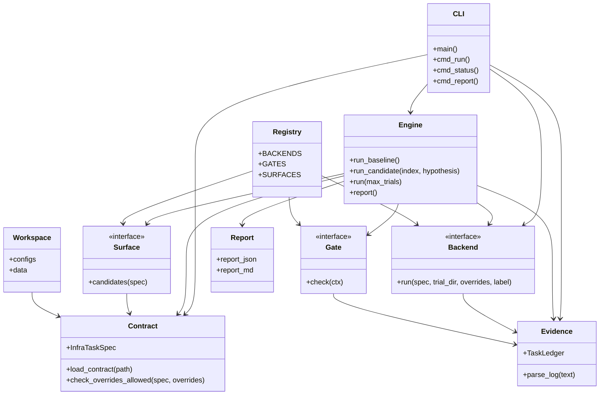

**组件职责**

| 组件 | 职责 | 关键边界 |
|---|---|---|
| CLI | 装载契约、构造 backend/ledger、打印报告 | 不裁决收益 |
| Contract | 冻结任务、可写键面、只读键、指标、门、预算 | 不生成候选 |
| Engine | baseline、候选循环、门、keep/discard/crash、报告 | 不导入 torch / HyperParallel |
| Backend | 执行单 trial，返回 `TrialResult` | 不判断收益 |
| Gate | receipt / bitwise / memory 检查 | 不修改 trial |
| Surface | 生成候选 `Hypothesis` | 只能输出契约允许的 override |
| Evidence | 日志解析、数值指纹、追加式账本 | 不裁决 |
| Registry | 注册 backend/gate/domain 插件 | 不绑定具体框架 |
| Workspace | 版本化配置与数据生成器 | 不属于运行时引擎 |
| Report | `report.json` / `report.md` | 由 Engine 生成 |

---

## 1.2 Contract 组件内部类图

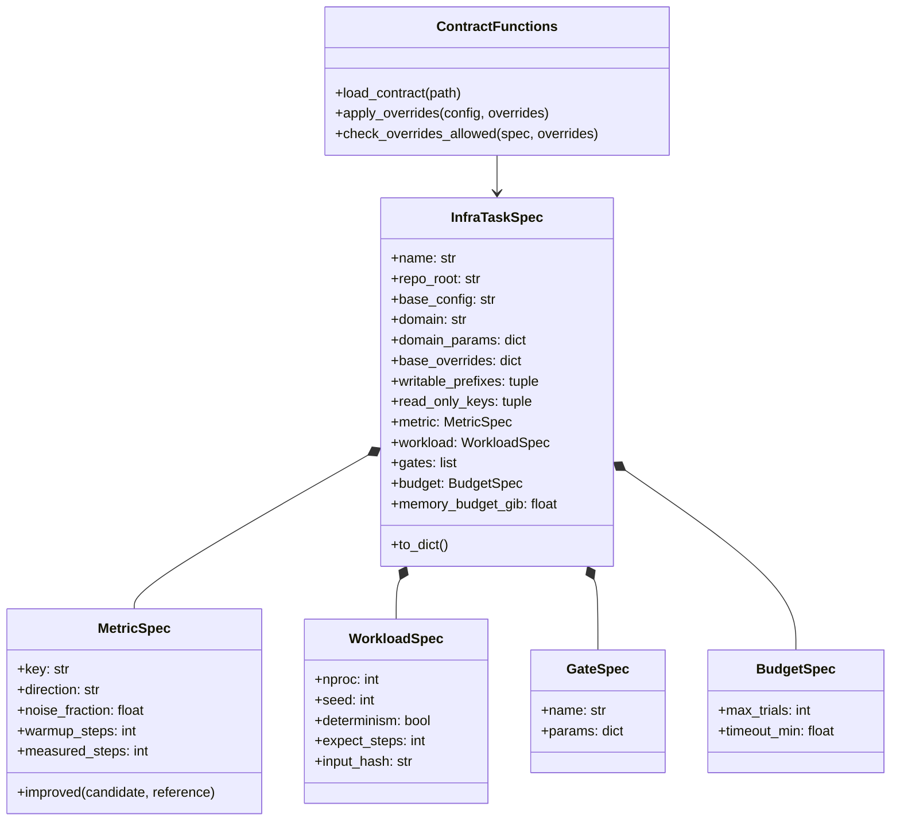

**内部关系**

- `InfraTaskSpec` 组合 metric/workload/gates/budget；`domain_params` 是通用插件参数。
- 候选 override 必须通过 `check_overrides_allowed`；只读键优先于可写前缀。

---

## 1.3 Engine 组件内部类图

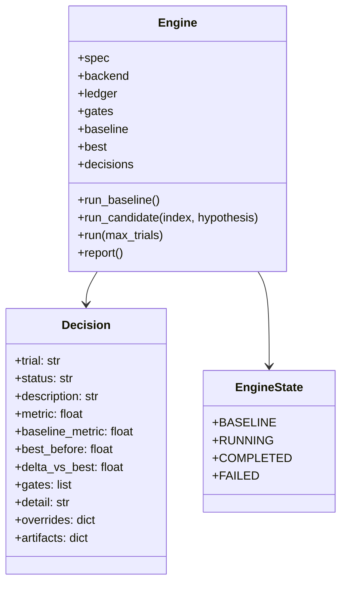

**内部关系**

- 每个候选生成 `Decision`：`keep` / `discard` / `crash`。
- baseline 失败则任务 `FAILED`；正常流程为 `BASELINE → RUNNING → COMPLETED`。

---

## 1.4 Backend 组件内部类图

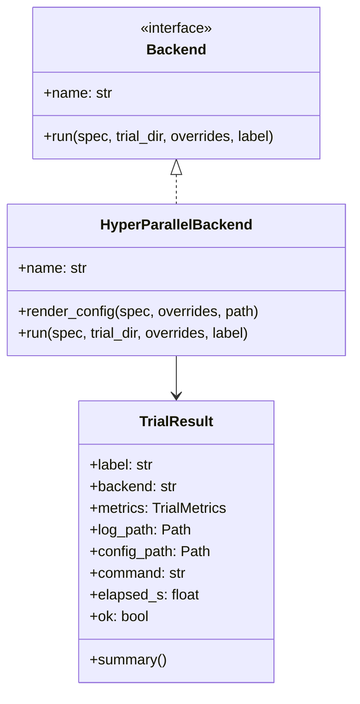

**内部关系**

- `HyperParallelBackend` 合并 `base_overrides` 与候选 override，写 `train.yaml`，调用 `torchrun`，处理超时与进程组清理。
- 它返回 `TrialResult`；`TrialMetrics` 由 Evidence 组件解析。

---

## 1.5 Gates 组件内部类图

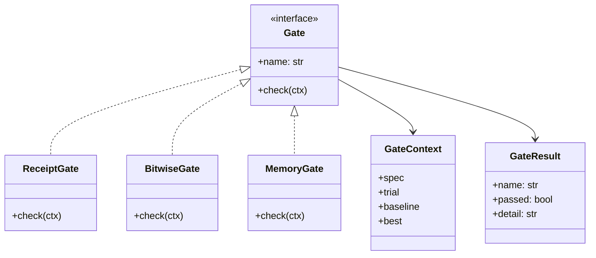

**内部关系**

- `ReceiptGate`：退出码、traceback、预期步数。
- `BitwiseGate`：loss/grad_norm 指纹与 baseline 相同。
- `MemoryGate`：峰值显存不超过 `memory_budget_gib`。

---

## 1.6 Surface 组件内部类图

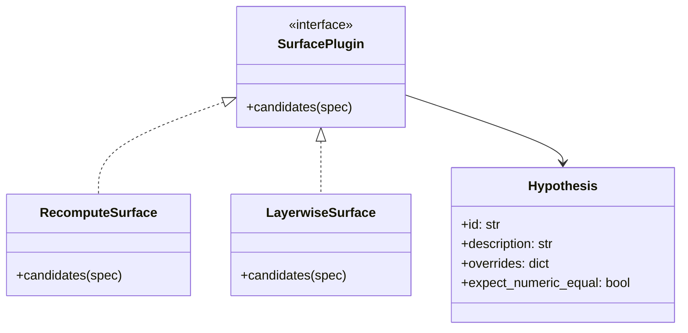

**内部关系**

- `RecomputeSurface`：`off` / `control` / `selective` / `selective-swap` / `full-swap`。
- `LayerwiseSurface`：`control` + `domain_params.layer_counts` 的 `layers-k` 阶梯。

---

## 1.7 Evidence 组件内部类图

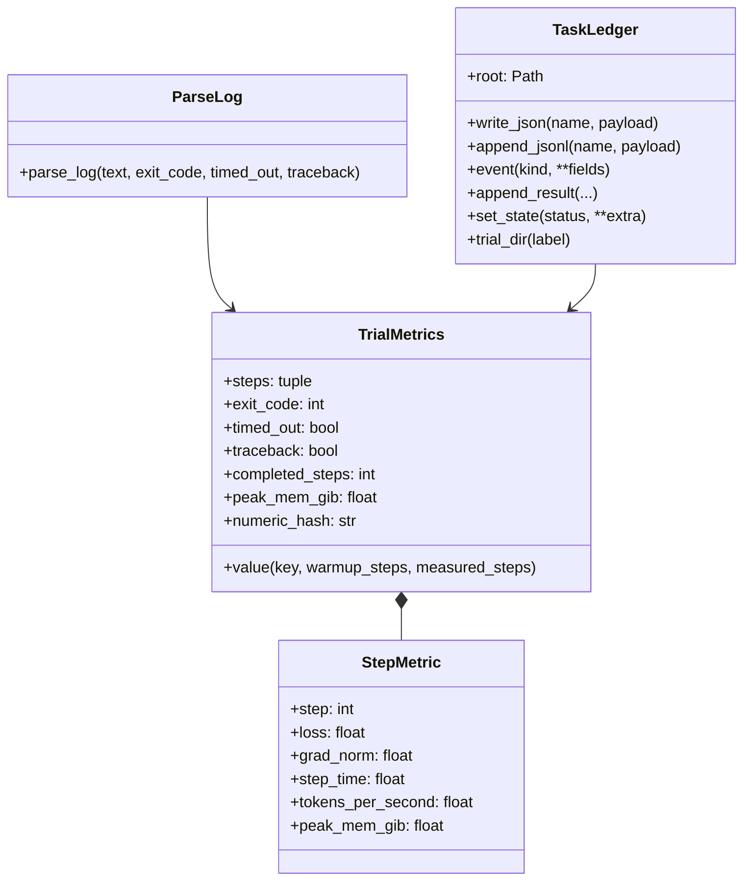

**内部关系**

- `ParseLog` 从训练日志逐 step 解析；`TrialMetrics` 组合 `StepMetric` 并生成数值指纹。
- `TaskLedger` 写 task/state/baseline/decisions/trials/results/report。

---

## 1.8 CLI / Registry 组件内部类图

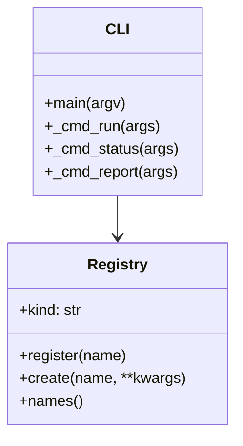

**内部关系**

- `Registry` 统一注册 `BACKENDS` / `GATES` / `SURFACES`；新增优化面 = 新 surface + 新契约。

---

# 二、HyperParallel PR #1517

## 2.1 组件级类图（整体）

> PR 的 RSI harness 不是独立顶层服务：实验控制器放在 `.agent/skills/autoresearch/scripts/` 和 `.agent/skills/mfu-riser/scripts/`；HyperParallel 运行时提供模型、Trainer、SAPP 和分布式执行面。

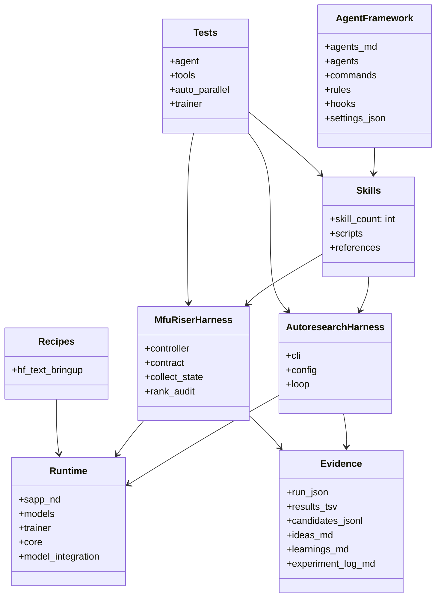

**组件职责**

| 组件 | 职责 | 关键边界 |
|---|---|---|
| AgentFramework | 入口、角色、命令、规则、hooks、settings | 只做 agent 入口与约束，不执行训练 |
| Skills | 27 个领域 skill：诊断、策略、正确性、工程、知识 | skill 是过程/工具，不是运行时服务 |
| AutoresearchHarness | commit → gate → benchmark → keep/restore + ledger | 确定性半边；不生成候选 |
| MfuRiserHarness | 有界 trial 控制器、契约、状态采集、rank 审计 | 控制器无第二个 LLM |
| Runtime | HyperParallel 模型/Trainer/SAPP/core | 提供训练和并行执行面 |
| Recipes | HF 文本 bring-up 套件 | 提供 build/prepare/train/equivalence 配方 |
| Tests | skill 契约、autoresearch 循环、MFU/FLOPs、SAPP | 验工具契约，不证明模型性能 |
| Evidence | run.json/results.tsv/candidates.jsonl/living docs | 证据与历史，不是裁决者 |

---

## 2.2 AgentFramework 组件内部类图

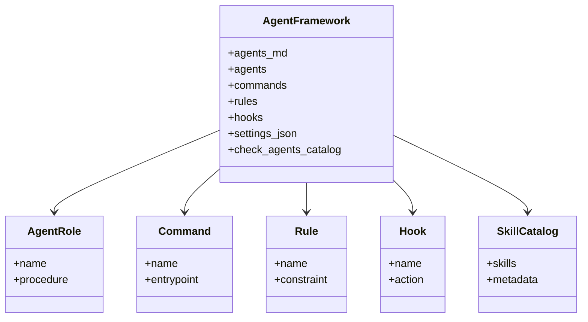

**内部关系**

- `AGENTS.md` 定义入口；`.agent/agents` 定义角色，`.agent/commands` 定义命令，`.agent/rules` 定义约束，`.agent/hooks` 定义执行动作。
- `.agent/scripts/check_agents_catalog.py` 校验 catalog 一致性；skills 由 catalog 管理。

---

## 2.3 Skills 组件内部类图

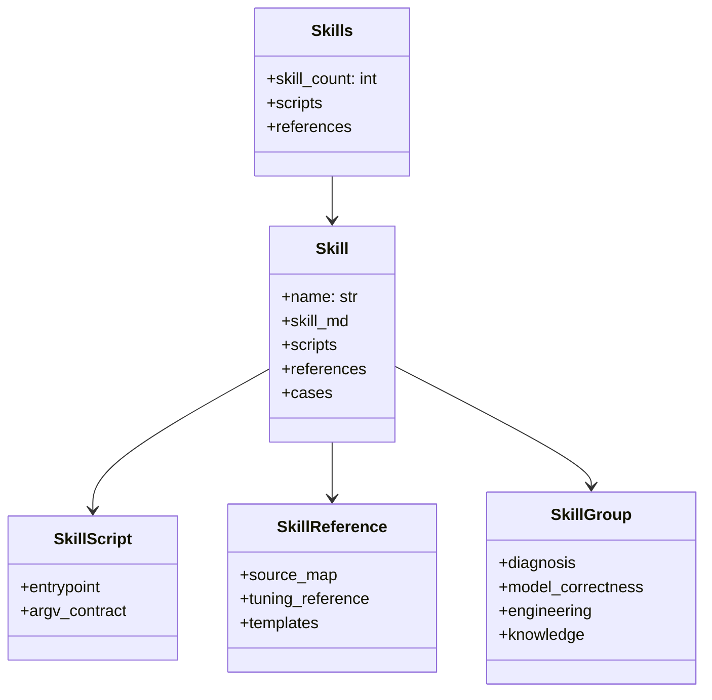

**内部关系**

- 27 个 skill 分三类：
  - 性能诊断/策略/实验：profiling、memory-analysis、perf-playbook、autoresearch、mfu-riser、moe-profiler、moe-optimizer、parallel-strategy-analyzer、sapp-parallel-strategy、strategy-validator、strategy-optimizer。
  - 模型集成/正确性：hf-model-integration、hf-model-precision-validation、precision、routing-validator、formal-verification、bringup-benchmark。
  - 工程/知识/交付：dist-op-analysis、dist-op-dev、add-unit-test、debug、cluster-debug、code-review、autogit、gate-doctor、feature-doc、knowledge-retrieval。
- skill 的 Python/Shell 脚本是工具；skill 本身不执行、不自动晋升。

---

## 2.4 AutoresearchHarness 组件内部类图

```mermaid
classDiagram
    direction TB

    class AutoresearchCLI {
        +main(argv)
    }

    class RunConfig {
        +repo_root
        +target_files
        +gate_command
        +benchmark_command
        +training_protocol
        +noise
    }

    class TrainingProtocol {
        +receipt_key
        +expected_steps
        +engaged_marker
        +failure_classes
    }

    class CommandResult {
        +returncode
        +stdout
        +stderr
        +receipt
    }

    class IterationOutcome {
        +commit
        +metric
        +status
        +gate
        +receipt
    }

    class AutoresearchLoop {
        +record_baseline()
        +iterate()
        +pending_retries()
        +run_status()
    }

    class Ledger {
        +results_tsv
        +candidates_jsonl
        +run_json
    }

    AutoresearchCLI --> RunConfig
    RunConfig --> TrainingProtocol
    AutoresearchLoop --> RunConfig
    AutoresearchLoop --> CommandResult
    AutoresearchLoop --> IterationOutcome
    AutoresearchLoop --> Ledger
```

**内部关系**

- `autoresearch.py` 是 CLI；`config.py` 定义 `RunConfig` / `TrainingProtocol`；`loop.py` 定义 `CommandResult` / `IterationOutcome` 与 `iterate`。
- 一次迭代：commit 目标文件 → gate → benchmark → 解析 metric 与 receipt → keep/discard/crash → 写账本 → keep 留下，否则用新前向 commit restore。
- 四条铁律：只测已 commit 代码；正证据 marker 缺失=crash；gate 失败=metric 作废；失败留历史，restore 用新 commit，best 恒为 HEAD。

---

## 2.5 MfuRiserHarness 组件内部类图

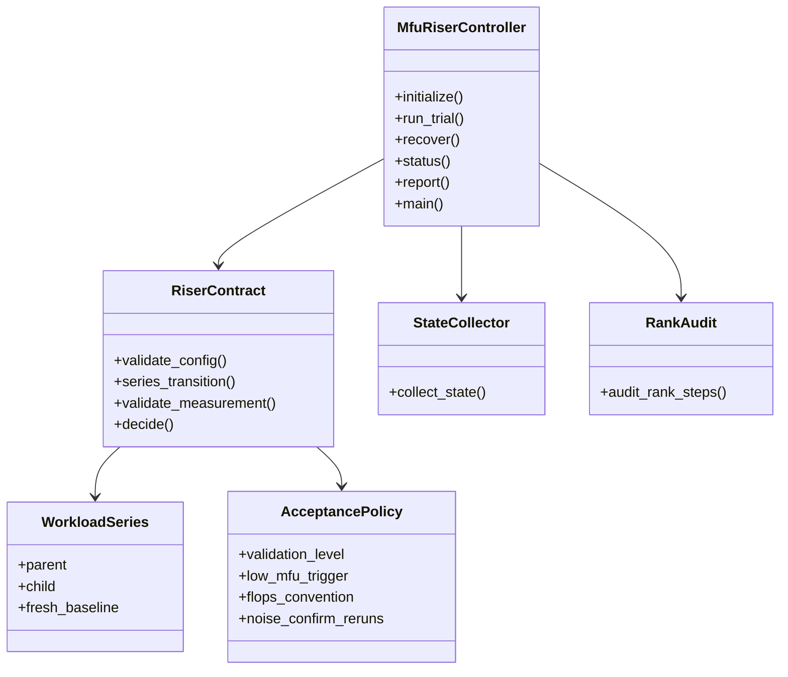

**内部关系**

- `mfu_riser.py` 是 bounded trial controller；`riser_contract/task_spec.py` 定义配置、workload、series、measurement、decision。
- `collect_state.py` 采集 profiling/state；`audit_rank_steps.py` 审计全 rank 完成度与 microbatch 覆盖。
- 接受条件：正确 + engaged + 完整 + 超噪声 + 稳态步 + 独立 confirm；controller 内无第二个 LLM，Agent 只当 planner。

---

## 2.6 Runtime / Recipes 组件内部类图

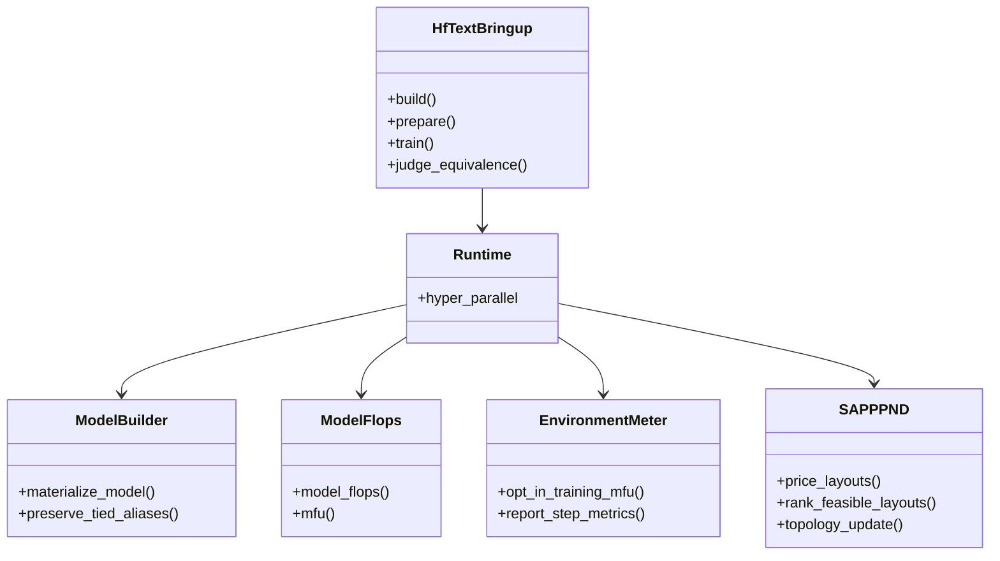

**内部关系**

- `hyper_parallel/` 提供 Model、Trainer、core、SAPP ND。
- `model_builder.py` 负责模型构造与 tied alias；`model_flops.py` 做模型 FLOPs；`environ_meter_callback.py` 做 opt-in MFU/step 计量。
- `hf_text_bringup/` 提供 build/prepare/train/equivalence 的可运行配方。

---

## 2.7 Tests / Evidence 组件内部类图

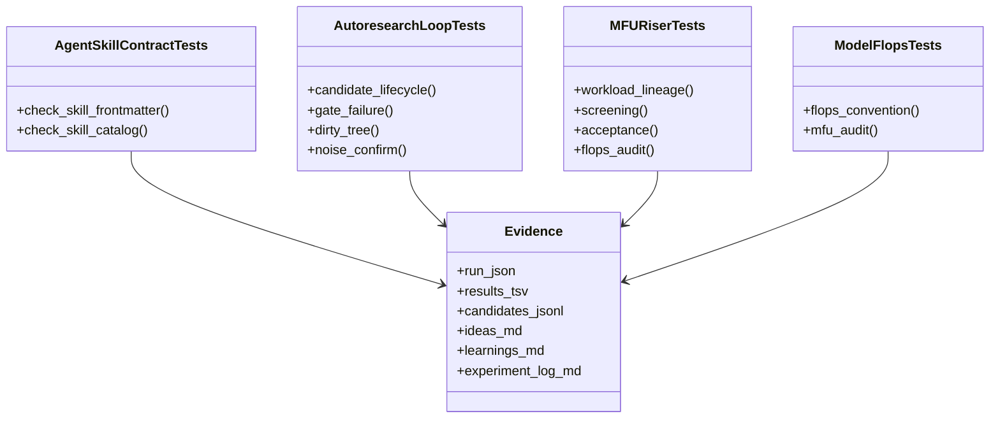

**内部关系**

- 测试覆盖 skill 契约、autoresearch 循环、MFU/FLOPs、SAPP、Trainer。
- `run.json` 是契约；`results.tsv` 是指标史；`candidates.jsonl` 是候选/commit/gate/marker 回执；living docs 是实验记忆。

---

# 三、组件映射与核心差异

| 维度 | infra-rsi | PR #1517 | 差异 |
|---|---|---|---|
| **架构单元** | 独立 Python 包 + CLI + plugin registry | `.agent/` 框架 + 27 skills + skills 内嵌 harness scripts + HyperParallel runtime | 我们是“引擎插件”；PR 是“agent skill 体系 + 内嵌控制器” |
| **契约** | `InfraTaskSpec`：key 级可写面/只读键/metric/gates/budget | `RunConfig` + `TrainingProtocol` + `riser_contract`：命令、target_files、workload、series、receipt | 键级配置契约 vs commit/gate/benchmark 协议 |
| **候选生成** | `SurfacePlugin` 自动枚举 `Hypothesis` | Agent 提出候选 patch；strategy-optimizer 做有界配置搜索；SAPP ND 做布局搜索 | 自动域枚举 vs agent/planner + 有界控制器 |
| **修改面** | `writable_prefixes` + `read_only_keys` | `target_files` 白名单 + 封闭 scope 枚举 + isolated workspace + source digest | 我们限制配置键；PR 限制代码文件/scope/源摘要 |
| **执行** | Backend 插件，当前 `HyperParallelBackend` + torchrun | `autoresearch` / `mfu-riser` 脚本调用 HyperParallel recipes | 单 backend 插件 vs 多控制器 + 配方 |
| **正确性门** | receipt / bitwise / memory | equivalence gate / precision parity / routing validator / formal verification / bringup benchmark | 我们三件套固定；PR 按改动类型分级 |
| **证据 marker** | 无 `engaged` 要求 | `engaged=1`、`fusion_active`、`fallback_correct` 等正证据 marker；缺失=crash | 这是最大 gap：我们只能证明数值不变，不能证明优化路径生效 |
| **裁决** | 每候选 `keep` / `discard` / `crash` | 每候选 keep/discard/crash + receipt + gate 状态 + failure class | 裁决单位相近，但 PR 有回执/失败分类 |
| **状态与提交** | trial 目录、ledger；不操作 repo commit | commit-before-test、dirty-tree 检查、restore 新前向 commit、best 恒为 HEAD | 我们缺 git 提交纪律 |
| **噪声/重试** | `noise_fraction` + no-op control | `noise_fraction` + `noise_confirm_reruns` + `--changes` / `--revisit-on` / `--retry-of` | 我们缺 confirm rerun 与依赖域重试 |
| **指标** | tokens_per_second + peak memory | MFU / HFU / effective tokens/s/device + FLOPs audit | 我们缺硬件归一化与算量审计 |
| **流水线** | contract → baseline → candidates → gates → report | S0 survey/planning → S1 adaptation → S2 correctness → S3 equivalence → S4 profile/optimize | 我们只有单段闭环；PR 有分阶段交接 |
| **覆盖范围** | activation_memory（recompute/layerwise） | 六个 scope：compute_fusion、equivalent_implementation、parallel_layout、communication、activation_memory、optimizer | 我们优化面窄 |
| **知识/回流** | 静态 docs/notes；无运行时知识层 | knowledge-retrieval、perf-playbook、living docs；人工审后晋升 case | 我们缺知识回流运行时 |
| **Agent** | 无 agent/ImplementerPort | host Agent 负责创意半边；controllers 无 LLM | 我们是自动搜索；PR 是 agent 辅助的搜索 |

---

# 四、gap 摘要与优先级

| Gap | PR #1517 的做法 | infra-rsi 现状 | 优先级 |
|---|---|---|---|
| **正证据 marker** | `engaged=1`、`fusion_active`、`fallback_correct`；缺失=crash | 只有 receipt/bitwise/memory | P0：否则 layerwise 快慢不可归因 |
| **训练回执/失败分类** | 单行 `RSI_TRAINING_RECEIPT`：phase/status/completed_steps/engaged/first_error_step + oom/numerical_mismatch/incomplete/contention/futile | `receipt` 解析 exit/traceback/steps；`crash` detail 笼统 | P0 |
| **commit / dirty-tree / source digest** | 只测已 commit 代码；target_files 白名单；dirty-tree 拒绝；`RISER_SOURCE_DIGEST` | trial 在 repo root 渲染配置运行；无 commit 检查 | P0 |
| **gate 分类** | 调度/等价→等价 gate；融合/精度→局部 parity+全模型容差；训练策略→审批协议 | 固定 receipt/bitwise/memory | P1 |
| **依赖域重试** | `--changes` / `--revisit-on` / `--retry-of` | 只有 `layers-k` 枚举 | P1：recompute×通信等交互 |
| **噪声确认** | `noise_confirm_reruns` 取中位数 | 有 noise_fraction，无 confirm rerun | P1 |
| **MFU/HFU** | MFU/HFU/tokens/s/device + FLOPs audit | tps + memory | P2：解释“拿 HFU 换显存” |
| **S0–S4** | 调研→适配→单机正确性→分布式等价→优化 | 直接 baseline→candidate | P2 |
| **知识回流** | perf-playbook case + living docs | 静态 docs | P3 |
| **agent/controller** | Agent 只 planner；controller 无 LLM | 无 agent | P3 |

**我们反而更强/不同的地方**

- `writable_prefixes` / `read_only_keys` 是显式键级安全面；PR 的文件白名单是代码文件级。
- `SurfacePlugin` 自动候选枚举是可复现的搜索列表；PR 的 agent 候选依赖 planner，但 strategy-optimizer 也做有界搜索。
- `memory_budget_gib` 是逐 trial 硬门；PR 有内存分析但更偏诊断与 SAPP 预算。
- `bitwise` 指纹逐位相同，强于一般等价检查；但没有 engaged marker 时只能证明数值不变。
- `Registry` 的 BACKENDS/GATES/SURFACES 插件化比 PR 的 skill/command/agent 体系更接近独立引擎。

---

# 五、结论

PR #1517 是 **agent 创意 + Python 控制器确定性 + git 提交纪律 + 回执/gate 分类 + 依赖域重试** 的训练 RSI 体系；infra-rsi 是 **contract 驱动 + surface 枚举 + 三道门 + 账本** 的配置搜索引擎。两者共享“冻结 workload、重复测量、执行失败当证据、不自动晋升知识”的原则，但 PR 在 **证据协议、提交纪律、gate 分级、交互重试、指标审计、分阶段流水线** 上明显更完整。

我们最该先补的不是更多 surface，而是：**`engaged` marker + `RSI_TRAINING_RECEIPT` + commit/dirty-tree/source digest**。这三项直接决定 layerwise recompute 的收益归因是否可信。
