# infra-rsi 与 InferRSI：分层架构类图

日期：2026-11-13  
组织方式：先给“组件级类图”，再逐组件给“组件内部类图”，最后单独列组件/模块差异。  
范围说明：`InferRSI` 只作对照阅读，不作为 `infra-rsi` 的实现依赖或参考代码。我们这边属于**产物 RSI**，优化对象是训练运行时产物（配置/模型策略），不是 harness 本身。

---

# 一、infra-rsi

## 1.1 组件级类图（整体）

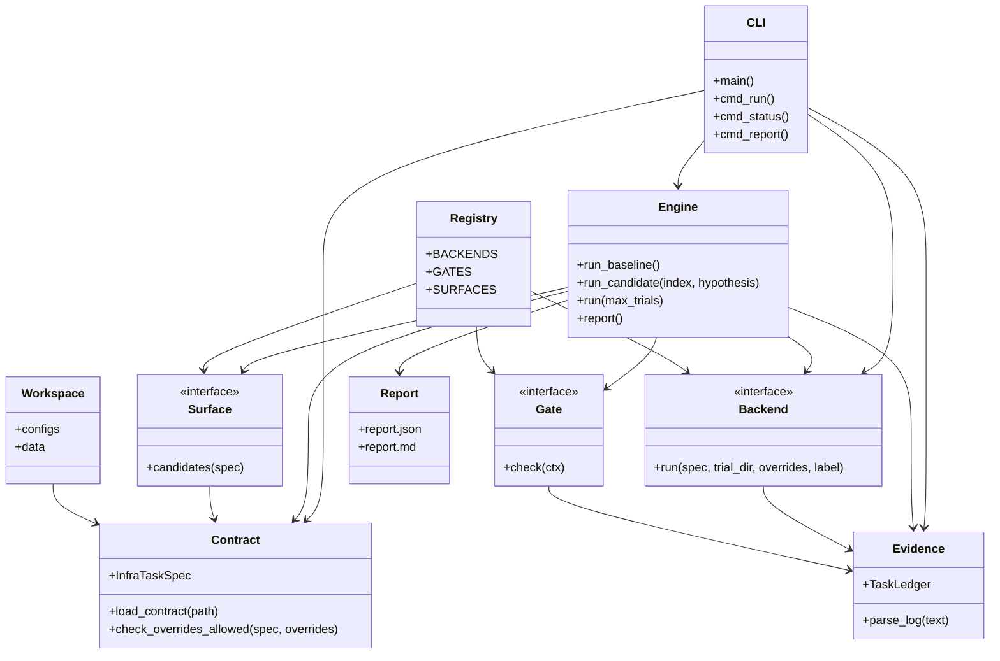

**组件职责**

| 组件 | 主要职责 | 关键边界 |
|---|---|---|
| CLI | 解析命令、装载契约、构造 backend/ledger、打印报告 | 不裁决收益 |
| Contract | 冻结任务、可写键面、只读键、指标、门、预算 | 不生成候选 |
| Engine | baseline、候选循环、门、keep/discard/crash、报告 | 不导入 torch / HyperParallel |
| Backend | 执行一个 trial，返回 `TrialResult` | 不判断收益 |
| Gate | 对 trial 做 receipt / bitwise / memory 检查 | 不修改 trial |
| Surface | 生成候选 `Hypothesis` | 只能输出契约允许的 override |
| Evidence | 日志解析、数值指纹、追加式账本 | 不裁决 |
| Registry | 注册 backend/gate/domain 插件 | 不绑定具体框架 |
| Workspace | 版本化运行输入（配置、数据生成器） | 不属于运行时引擎 |
| Report | `report.json` / `report.md` | 由 Engine 生成 |

---

## 1.2 Contract 组件内部类图

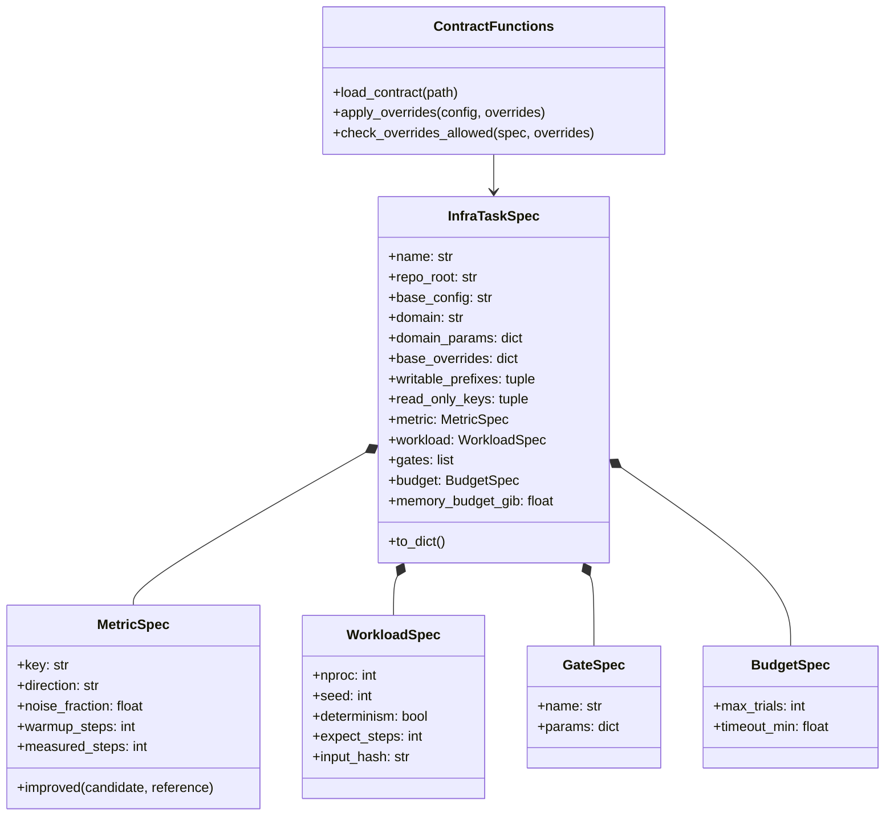

**内部关系**

- `InfraTaskSpec` 组合 `MetricSpec`、`WorkloadSpec`、`GateSpec`、`BudgetSpec`。
- `ContractFunctions` 负责加载 YAML、应用 dotted override、拒绝越界/只读键。
- `domain_params` 是通用插件参数，当前由 `recompute-layerwise` 读取 `layer_counts`。

---

## 1.3 Engine 组件内部类图

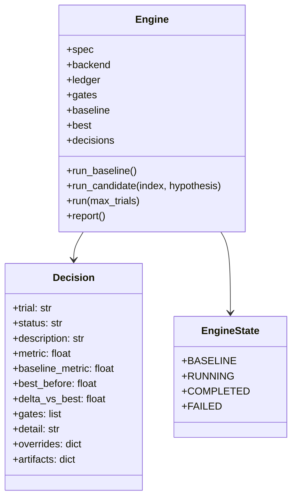

**内部关系**

- `Engine` 每个候选生成一个 `Decision`。
- `Decision.status` 为 `keep` / `discard` / `crash`。
- `EngineState` 是账本状态：`BASELINE → RUNNING → COMPLETED`，baseline 失败则 `FAILED`。
- Engine 依赖外部组件的 `Backend`、`Gate`、`TaskLedger`，但这些不是 Engine 内部类。

---

## 1.4 Backend 组件内部类图

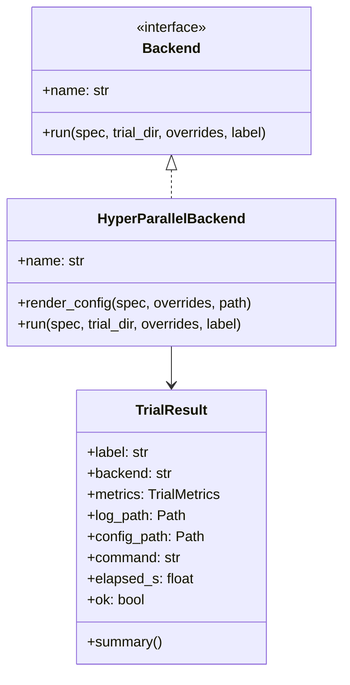

**内部关系**

- `Backend` 是协议；`HyperParallelBackend` 是框架专用实现。
- `HyperParallelBackend` 合并 `base_overrides` 与候选 overrides，写 `train.yaml`，调用 `torchrun`，处理超时与进程清理，返回 `TrialResult`。
- `TrialResult.metrics` 的类型 `TrialMetrics` 来自 Evidence 组件。

---

## 1.5 Gates 组件内部类图

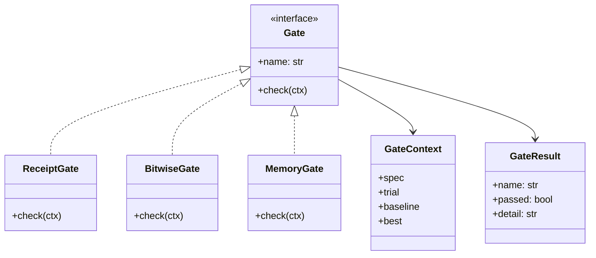

**内部关系**

- `GateContext` 提供 spec、trial、baseline、best；门只读，不修改 trial。
- `ReceiptGate`：退出码、traceback、预期步数。
- `BitwiseGate`：loss/grad_norm 指纹与 baseline 相同。
- `MemoryGate`：峰值显存不超过预算。

---

## 1.6 Surface 组件内部类图

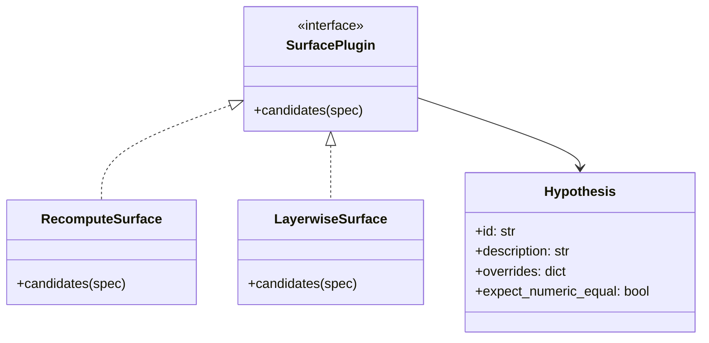

**内部关系**

- `SurfacePlugin` 返回 `Hypothesis` 序列。
- `RecomputeSurface`：`off` / `control` / `selective` / `selective-swap` / `full-swap`。
- `LayerwiseSurface`：`control` + `domain_params.layer_counts` 驱动的 `layers-k` 阶梯。
- 候选 override 必须通过 `Contract.check_overrides_allowed`。

---

## 1.7 Evidence 组件内部类图

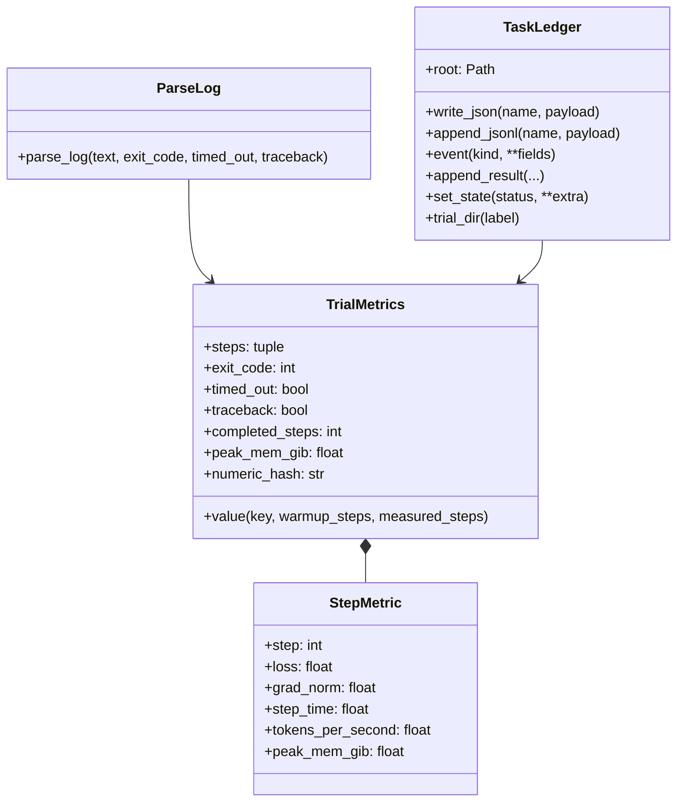

**内部关系**

- `ParseLog` 从训练日志逐 step 解析，生成 `TrialMetrics`。
- `TrialMetrics` 组合 `StepMetric`，提供 completed steps、峰值显存、numeric hash。
- `TaskLedger` 写入 task/state/baseline/decisions/trials/results/report 等证据。

---

## 1.8 CLI / Registry 组件内部类图

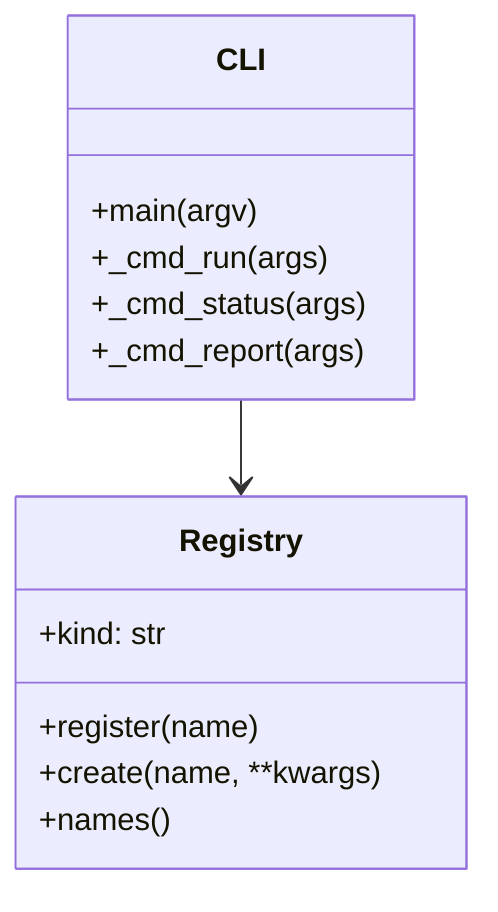

**内部关系**

- `CLI` 负责 `run` / `status` / `report`。
- `Registry` 是通用插件注册器；`BACKENDS`、`GATES`、`SURFACES` 是三个实例。
- 新增优化面 = 新 surface + 新契约；引擎不需要改。

---

# 二、InferRSI

## 2.1 组件级类图（整体）

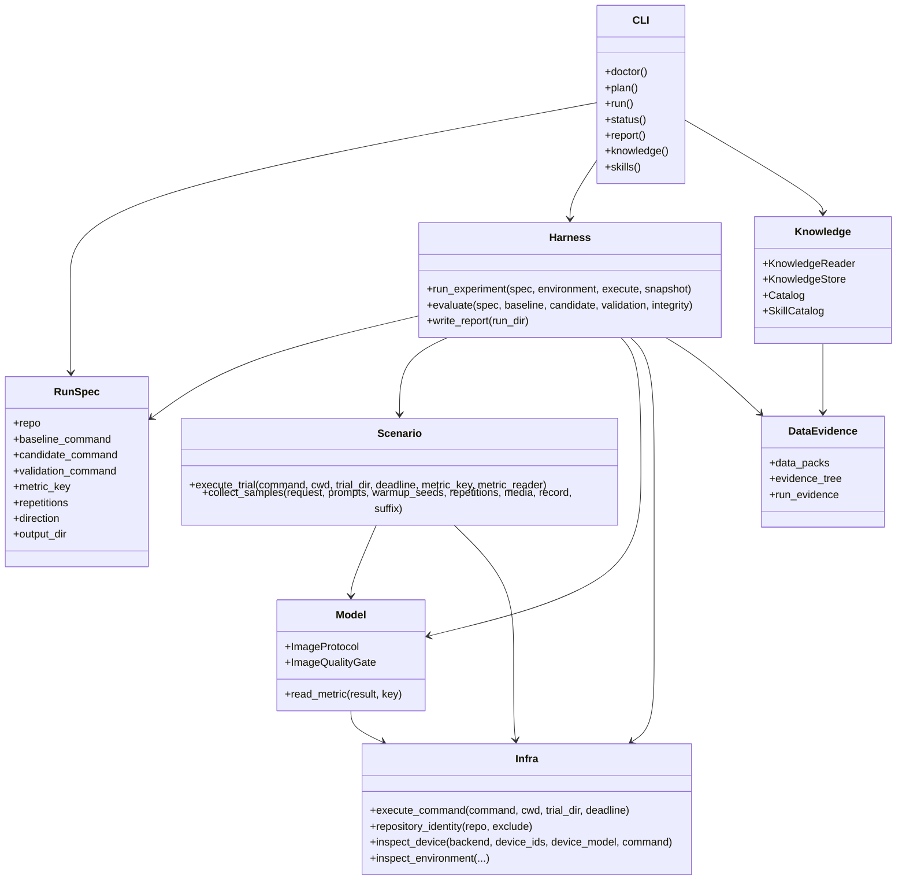

**组件职责**

| 组件 | 主要职责 | 关键边界 |
|---|---|---|
| CLI / Entry | argparse、RunSpec 构造、knowledge/skills 命令 | 不自动规划、不改源码 |
| RunSpec | 冻结命令、指标、重复次数、方向、质量命令 | 不声明 key 级可写面 |
| Harness | AB/BA、deadline、源码快照、裁决、报告 | 不绑定设备/模型请求 |
| Scenario | 外部 benchmark 执行、媒体采样 | 复用通用 executor 与 metric reader |
| Model | 指标、图像请求、图像质量协议 | 不调度进程、不选硬件 |
| Infra | 进程、清理、Git 身份、平台探测、HTTP、证据哈希 | 不做 performance verdict |
| Knowledge | 知识检索、技能目录、Bundle/Store | 读取不执行、不自动晋升 |
| Data / Evidence | knowledge packs、skill library、campaign 证据树 | 知识不是运行结果 |

---

## 2.2 Entry / Contract 组件内部类图

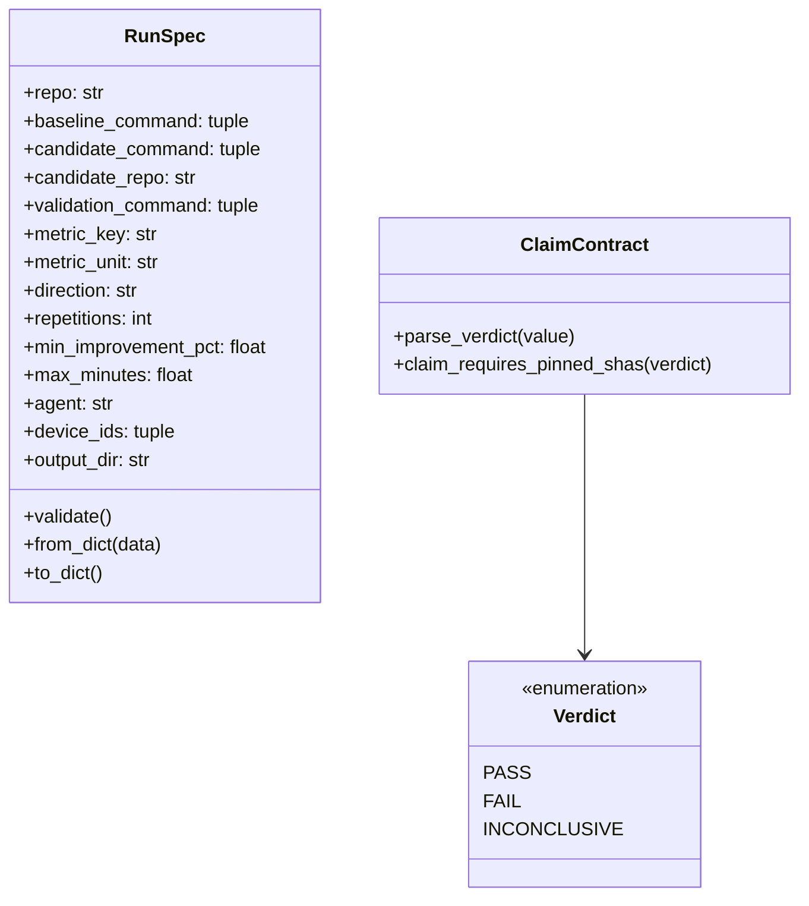

**内部关系**

- `RunSpec` 是命令级实验契约；`mode=config/code/semantic` 只是标签，不是 key 级 edit surface。
- `Verdict` 是 campaign 的三种裁决标签。
- `ClaimContract` 规定 PASS 需要 pinned SHA，但 SHA 本身在验收 issue/evidence 中。

---

## 2.3 Harness 组件内部类图

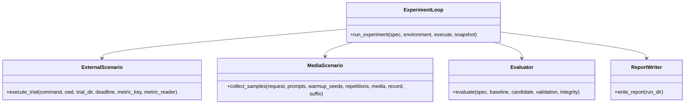

**内部关系**

- `ExperimentLoop` 负责重复的 AB/BA 顺序、deadline、命令前后源码快照、状态记录。
- `ExternalScenario` 只负责执行外部命令并读取 metric；`MediaScenario` 负责媒体 warmup/采样。
- `Evaluator` 做 campaign 级裁决；`ReportWriter` 写 HTML 报告。
- 跨组件依赖：ExperimentLoop 使用 Infra 的 snapshot/executor；ExternalScenario 使用 Model 的 metric reader。

---

## 2.4 Model 组件内部类图

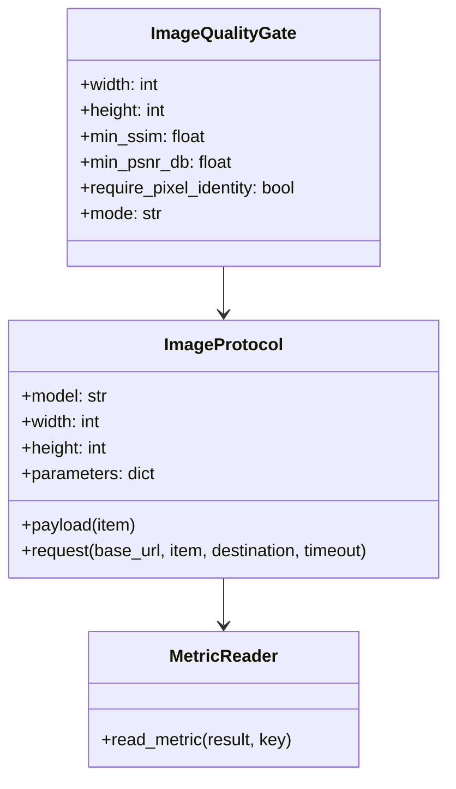

**内部关系**

- `MetricReader` 是 dotted-key、有限正数指标契约。
- `ImageProtocol` 负责 OpenAI 风格请求与 PNG 响应。
- `ImageQualityGate` 负责尺寸/模式/SSIM/PSNR/像素一致性检查。
- 跨组件依赖：`ImageProtocol` 使用 Infra 的 HTTP transport；`ImageQualityGate` 使用 Infra 的 sha256。

---

## 2.5 Infra 组件内部类图

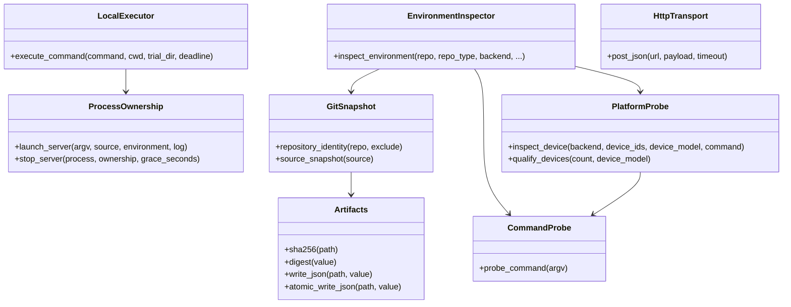

**内部关系**

- `LocalExecutor` 执行 argv、处理 deadline/取消，`ProcessOwnership` 负责进程组/Windows Job 清理。
- `GitSnapshot` 指纹 HEAD、diff、untracked；`Artifacts` 提供哈希/JSON 写入。
- `EnvironmentInspector` 组合仓库身份、Python 包版本、设备探测。
- `PlatformProbe` 通过 `CommandProbe` 调用 `nvidia-smi` / `rocminfo` / `npu-smi`。
- `HttpTransport` 只做 HTTP 计时，不解释响应。

---

## 2.6 Knowledge 组件内部类图

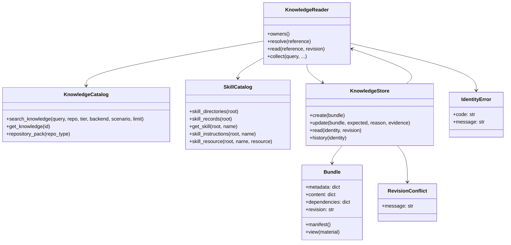

**内部关系**

- `KnowledgeReader` 统一读取 package / checkout / store 三类 authority。
- `KnowledgeStore` 用 SQLite 保存 revisions/current/resources；create/update 不能晋升状态。
- `Bundle` 是带 metadata/content/dependencies 的完整资源，`revision` 由 manifest 哈希决定。
- `IdentityError` / `RevisionConflict` 处理身份冲突和 revision 不可用。

---

## 2.7 Data / Evidence 组件内部类图

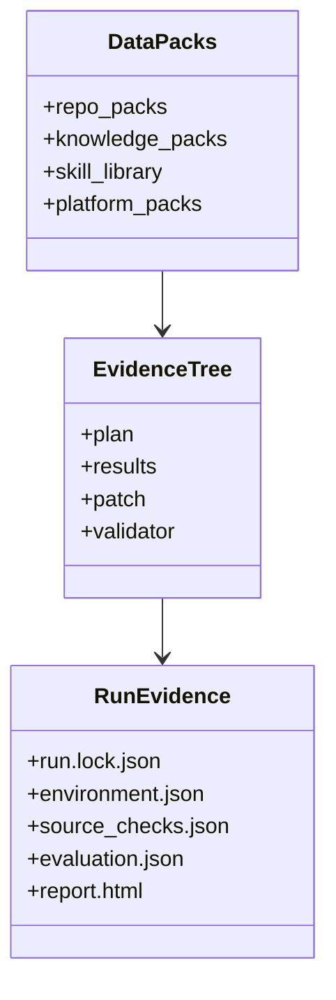

**内部关系**

- `DataPacks` 是知识/技能/平台包的打包数据。
- `EvidenceTree` 是 campaign 级证据结构。
- `RunEvidence` 是单次实验的冻结 RunSpec、环境、源码检查、裁决和报告。
- 这里不是运行时类，而是证据布局。

---

# 三、组件与模块差异

| 组件 | infra-rsi | InferRSI | 关键差异 |
|---|---|---|---|
| **Contract / 输入** | `InfraTaskSpec`：键级可写面、只读键、domain、domain_params、metric、gates、budget | `RunSpec`：repo、baseline/candidate 命令、metric_key、repetitions、validation_command | 一个冻结“可改哪些配置键”，一个冻结“可执行哪些命令”；没有 key 级安全面 |
| **候选来源** | `SurfacePlugin` 自动枚举 `Hypothesis` | 调用者/agent 提供 `candidate_command` / `candidate_repo` | infra-rsi 有搜索空间引擎；InferRSI 没有候选枚举器 |
| **执行** | `Backend` 插件，当前为 `HyperParallelBackend` + `torchrun` | `Scenario` + `LocalExecutor`，执行任意 argv | 框架专用后端 vs 通用命令执行 |
| **测量** | 训练日志逐 step 解析；tps、loss/grad_norm、峰值显存 | 外部 benchmark JSON 的 dotted metric；重复 trial median/range | 日志协议 vs 结果 JSON 协议 |
| **正确性门** | receipt / bitwise / memory | 测量完整性 / validation_command / source_integrity / image quality | 数值等价 + 资源上限 vs 命令完成 + 质量 + 来源完整性 |
| **裁决单位** | 每候选 `keep` / `discard` / `crash` | campaign 级 `PASS` / `FAIL` / `INCONCLUSIVE` | trial 状态机 vs campaign 裁决 |
| **证据** | `TaskLedger`：task/state/baseline/decisions/trials/results/report | run 证据 + campaign `plan/results/patch/validator` | 运行账本 vs 运行证据 + 冻结证据树 |
| **知识层** | 只有设计文档，运行时知识层未实现 | 三层知识、48 个注册 skill、69 个 SKILL.md、两矩阵、Reader/Store | InferRSI 的知识系统成熟；infra-rsi 仍是后续工作 |
| **扩展** | `Registry` 统一注册 BACKENDS/GATES/SURFACES | `execute`/`snapshot`/`metric_reader` 钩子 + 场景 + 平台 probe | 统一插件注册 vs 组合式适配器 |
| **自动化** | 自动闭环：枚举候选 → 执行 → 门 → 决策 | agent 辅助：调用者做 profiling/代码修改，工具只执行与裁决 | 自动搜索 vs 可审计工作台 |

---

# 四、相同点与定位

**相同点**

- 都先冻结实验定义（contract / RunSpec），再执行。
- 都避免单次结论：infra-rsi 用 control + noise band；InferRSI 用 AB/BA 重复 + median/range。
- 都把执行失败当作证据，而不是直接宣布收益。
- 都输出机器可读证据 + 人类可读报告。
- 都把 harness 与模型/框架/设备解耦；都有模块边界测试。

**定位结论**

- `infra-rsi` = **训练产物 RSI 引擎**：可写键面、域枚举、后端执行、三道门、账本；自动闭环是核心。
- `InferRSI` = **推理产物评估工作台**：命令级 RunSpec、AB/BA、来源完整性、质量验证、PASS/FAIL/INCONCLUSIVE、知识/证据体系；候选由调用者/agent 提供。
- 两者都不是“优化 harness 本身”的 harness RSI；我们这边属于产物 RSI，不应按 InferRSI 的 agent 工作台模式重构。

**可借鉴但不要照搬**

- AB/BA 交替重复，可降低顺序漂移。
- 命令前后源码/产物快照，可补“实验期间源码未变”的证据门。
- `INCONCLUSIVE` 三态裁决，可区分“证据不完整”和“crash”。
- campaign 证据树 `plan/results/patch/validator` 可映射到 contract/trials/decisions/patch。
- 知识层接口可作为 L1/L3 参考，但 SQLite store 对当前阶段过度设计。

---

# 五、参考路径

- infra-rsi：`irsi/contract/task_spec.py`, `irsi/engine.py`, `irsi/registry.py`, `irsi/execution/backends/base.py`, `irsi/execution/backends/hyperparallel.py`, `irsi/gates/base.py`, `irsi/gates/builtin.py`, `irsi/contract/surfaces/base.py`, `irsi/contract/surfaces/recompute.py`, `irsi/execution/metric_extractor.py`, `irsi/knowledge/runtime/ledger_store.py`, `irsi/cli.py`
- InferRSI：`docs/architecture.md`, `src/inferrsi/runspec.py`, `src/inferrsi/claim.py`, `src/inferrsi/harness/runner.py`, `src/inferrsi/harness/evaluation.py`, `src/inferrsi/harness/reporting.py`, `src/inferrsi/harness/scenarios/external.py`, `src/inferrsi/model/protocols/metrics.py`, `src/inferrsi/model/protocols/image.py`, `src/inferrsi/model/validators/image.py`, `src/inferrsi/infra/executors/local.py`, `src/inferrsi/infra/processes.py`, `src/inferrsi/infra/targets/git.py`, `src/inferrsi/infra/platforms/*`, `src/inferrsi/knowledge_operations.py`, `src/inferrsi/knowledge_store.py`, `evidence/README.md`
