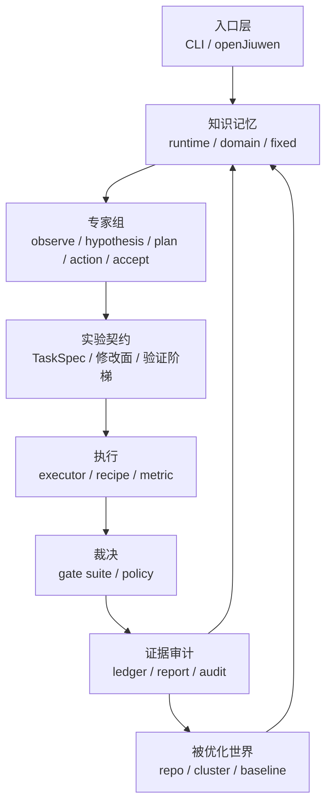
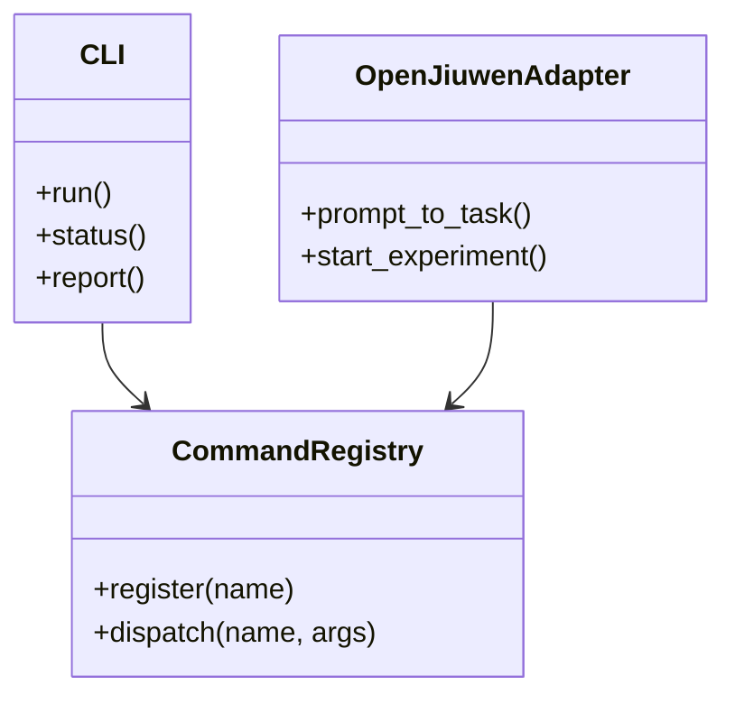
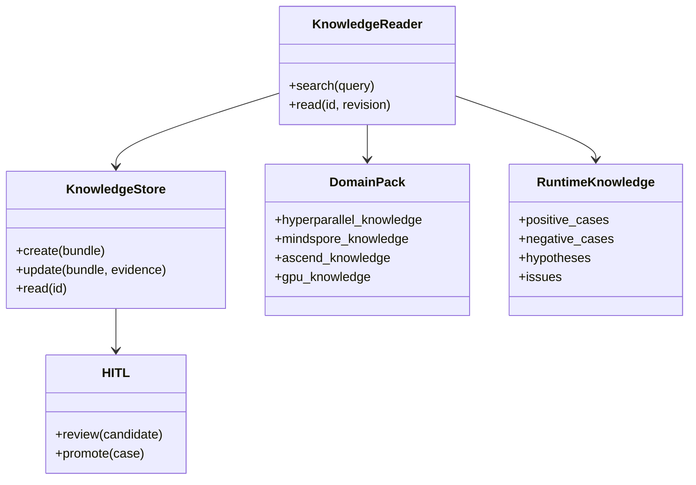
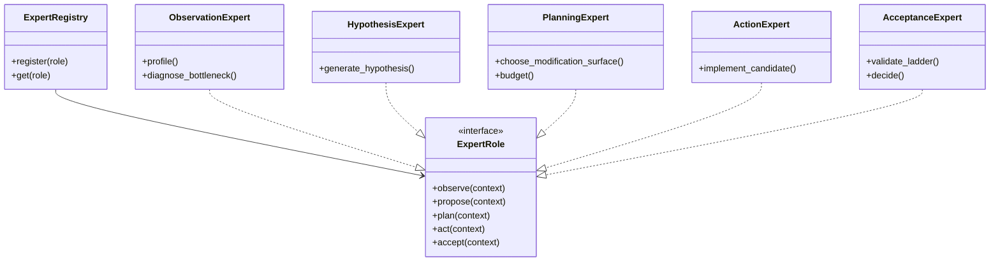
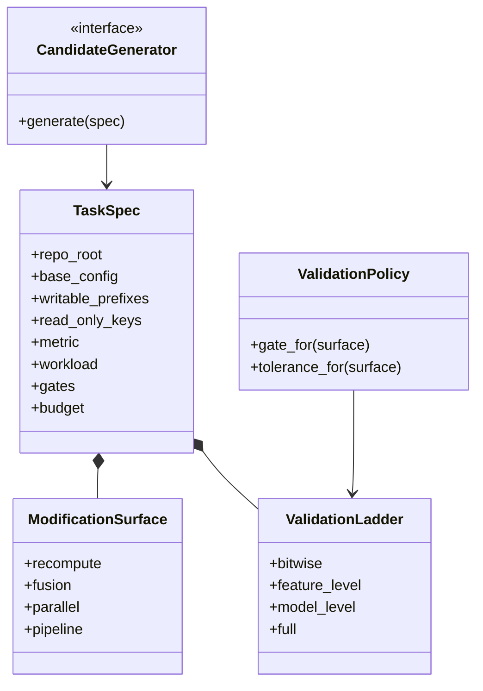
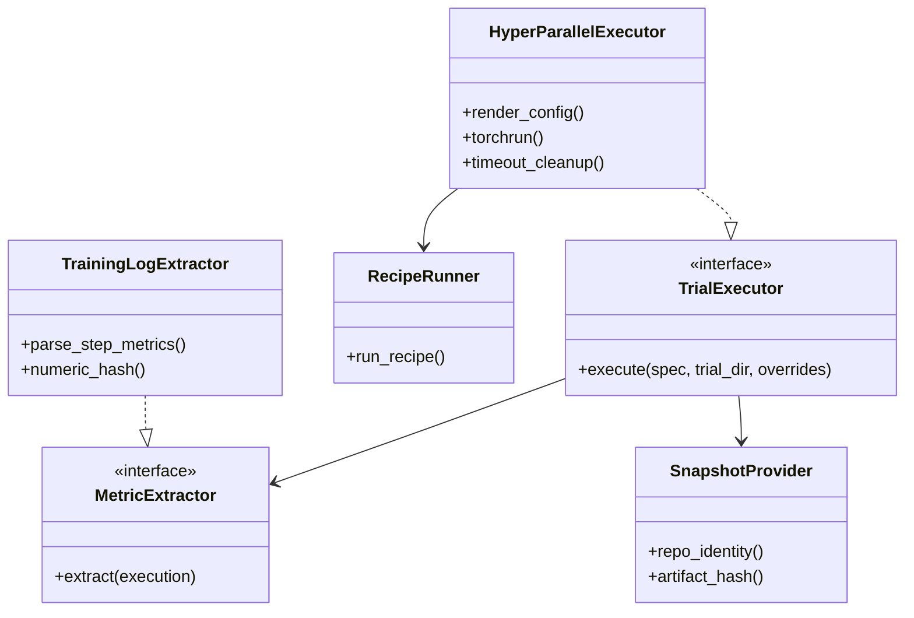
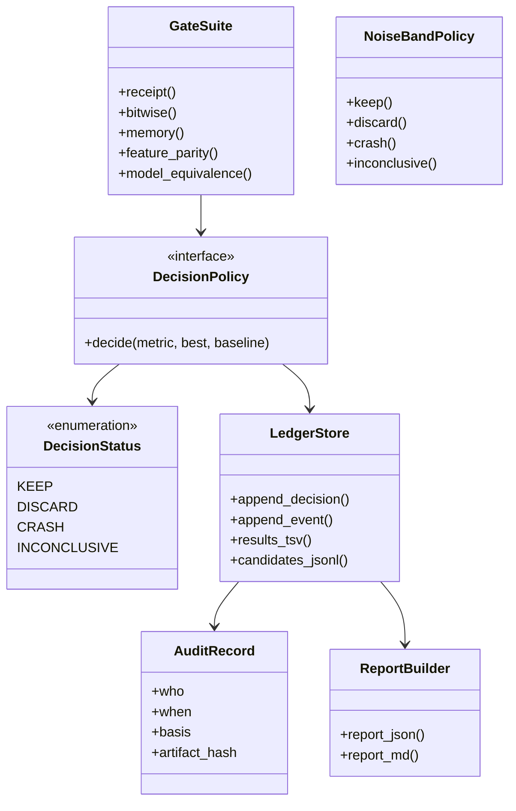
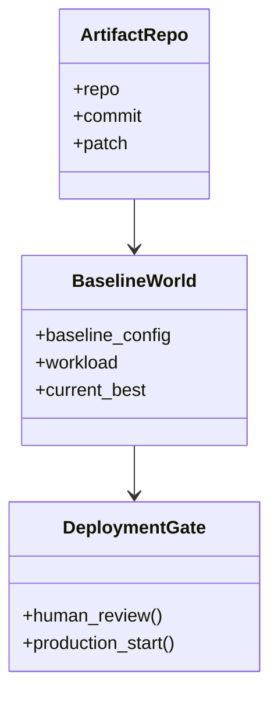

# infra-rsi 分层组件设计（按“一图闭环”重拆）

日期：2026-11-13  
依据：`agent-for-infra-layers-and-flow.standalone.html` 的七层闭环；对照 `InferRSI` 的 Harness / Model / Infra / Knowledge 边界，以及 HyperParallel PR #1517 的 AgentFramework / Skills / Autoresearch / MFU Riser / Runtime 边界。  
原则：**总图只画层与层的关系；每个层单独画内部组件；跨层只暴露协议，不把所有实现类连成一张蜘蛛网。**

---

## 1. 图的层 → 组件

| 图中的层 | 对应组件 | 职责 |
|---|---|---|
| 入口层 | **Entry / Orchestration** | CLI、openJiuwen prompt/入口、命令分发 |
| 知识与记忆 | **Knowledge / Memory** | 运行时知识、领域知识、固化知识、HITL |
| 专家组 | **Experts** | 观察、假设、规划、行动、验收角色 |
| 实验契约 · 修改面 × 验证阶梯 | **Experiment Contract** | TaskSpec、修改面、候选生成、验证阶梯 |
| RSI native AI framework / 执行与验证 | **Execution** | 执行器、配方、指标抽取、源快照 |
| 证据归档与审计 | **Decision / Audit** | 门、裁决、账本、报告、审计 |
| 被优化的世界 | **World / Baseline** | 仓库/产物、生产集群、下一轮 baseline、上线门 |

---

## 2. 闭环总图（只画层间关系）

**读法**

- `Entry` 不直接执行训练；它只装载契约、触发编排、选择专家。
- `Knowledge` 给专家提供正例/反例/假设/issue，不直接产出候选。
- `Experts` 把知识转成假设与行动方案；它们是角色/协议，不是引擎。
- `Contract` 冻结修改面和验证阶梯；候选只能落在允许的面上。
- `Execution` 只负责跑和采集，不裁决。
- `Decision` 只做门与裁决，不修改 trial。
- `Evidence` 只记账/报告/审计，不裁决。
- `World` 是下一轮 baseline；上线必须走人审门。

---

## 3. 逐层组件内部类图

### 3.1 入口层：Entry / Orchestration

**边界**

- `CLI` / `OpenJiuwenAdapter` 只负责入口与命令，不执行训练。
- `CommandRegistry` 是插件入口，不是候选生成器。

---

### 3.2 知识层：Knowledge / Memory

**边界**

- `KnowledgeReader` 只读；`KnowledgeStore` 只存候选/案例。
- `RuntimeKnowledge` 与 `DomainPack` 分开：运行时经验 vs 领域/硬件知识。
- `HITL` 是人工审，不自动晋升。

---

### 3.3 专家组：Experts

**边界**

- 专家是角色协议，不是引擎；具体实现可以是 skill/prompt 或 Python 插件。
- `ObservationExpert` 只出事实；`HypothesisExpert` 只提假设；`AcceptanceExpert` 只裁决。

---

### 3.4 实验契约：Experiment Contract

**边界**

- `TaskSpec` 冻结 workload、只读键、预算；修改面只允许声明过的 surface。
- `ValidationLadder` 不是门本身，而是“从便宜到贵”的等级定义；门由 `ValidationPolicy` 选择。
- 当前 infra-rsi 只实现了 recompute + bitwise；fusion/parallel/pipeline 仍是扩展点。

---

### 3.5 执行层：Execution

**边界**

- `TrialExecutor` 只负责“跑 + 原始日志 + 退出码”，不解析指标。
- `MetricExtractor` 负责把日志/结果转成 `TrialMetrics`。
- `SnapshotProvider` 负责源/产物哈希；裁决层消费它。

---

### 3.6 裁决与审计：Decision / Audit

**边界**

- `GateSuite` 只给结果；`DecisionPolicy` 才裁决。
- `INCONCLUSIVE` 与 `CRASH` 分开：证据不足 vs 执行失败。
- `AuditRecord` 是账本字段，不是裁决者。

---

### 3.7 被优化世界：World / Baseline

**边界**

- `ArtifactRepo` 是产物身份；`BaselineWorld` 是下一轮 baseline。
- `DeploymentGate` 是全量 PASS 之后的人审上线，不是 RSI 引擎自己部署。

---

## 4. 与 InferRSI、HyperParallel PR #1517 的对照

| 我们的层 | InferRSI | PR #1517 |
|---|---|---|
| Entry / Orchestration | `cli.py` + `RunSpec` | `AGENTS.md` + `.agent/commands` + agents |
| Knowledge | `KnowledgeReader` / `KnowledgeStore` / `SkillCatalog` | `knowledge-retrieval`、`perf-playbook`、living docs |
| Experts | 调用者/agent（manual，无运行时专家） | skills + agents 角色：观察/决策/行动/验收 |
| Experiment Contract | `RunSpec`：命令、metric、repetitions、validation | `RunConfig` + `TrainingProtocol` + `target_files` + scope |
| Execution | `infra/executors` + `scenarios` | `autoresearch` / `mfu-riser` + HyperParallel recipes |
| Decision / Audit | `harness/evaluation` + `report.html` + evidence | `RSI_TRAINING_RECEIPT` + gate 分类 + ledger/audit |
| World / Baseline | repo/commands/environment | HyperParallel runtime + recipes；生产部署仍缺 |

**共同可读结构**

- 都先冻结契约，再执行。
- 都把“执行器”与“裁决器”分开。
- 都把证据写成独立账本/报告。
- 都不把知识读取当成执行或自动晋升。

---

## 5. 现有 infra-rsi 代码映射

| 目标组件 | 现有代码 | 状态 | 需要拆/补 |
|---|---|---|---|
| Entry | `cli.py` | 有 CLI | 缺 openJiuwen/prompt 入口 |
| Knowledge | 只有 `docs/phase1-l1-runtime-knowledge.md`、L3 文档 | 未实现 | 缺 Reader/Store/HITL |
| Experts | 无 | 未实现 | 缺 ExpertRole/Registry |
| Contract | `contract.py` | 有 TaskSpec | 缺 ModificationSurface / ValidationLadder |
| Candidate | `domain/recompute.py` | 工厂函数 | 改为 `CandidateGenerator` 类/协议 |
| Execution | `backends/hyperparallel.py` + `receipt.py` | 执行与解析混在一起 | 拆 `TrialExecutor` + `MetricExtractor` |
| Decision | `engine.py` | 编排+决策+报告混在一起 | 拆 `ExperimentRunner` + `DecisionPolicy` |
| Evidence | `ledger.py` + report | 有账本 | 拆 `LedgerStore` + `ReportBuilder` + `AuditRecord` |
| World | `workspace/` + `patches/` | 有输入/产物 | 缺 baseline/deployment 门 |
| Registry | `registry.py` | `Registry[object]` | 改为 typed registry |

---

## 6. 结论

按图拆分后，infra-rsi 不应再画成“CLI → Contract → Engine → Backend/Gate/Domain”的一条总线，而应画成**七层闭环**：

1. Entry
2. Knowledge
3. Experts
4. Contract
5. Execution
6. Decision / Audit
7. World / Baseline

当前代码只完整覆盖 **Contract、Execution、Decision/Audit、Entry** 四层；**Knowledge、Experts、World/Deployment** 仍是缺口。InferRSI 的可读性来自“Harness / Model / Infra / Knowledge”边界；PR #1517 的可读性来自“AgentFramework / Skills / Harness scripts / Runtime / Tests / Evidence”边界。我们应借用这种“层 + 协议 + 具体实现”的拆分，而不是把所有类画进一张总图。
