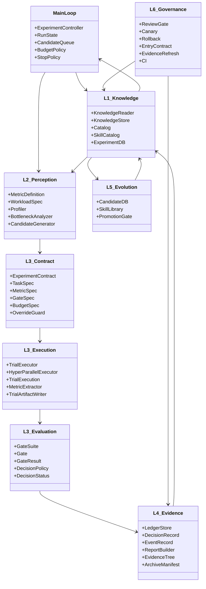
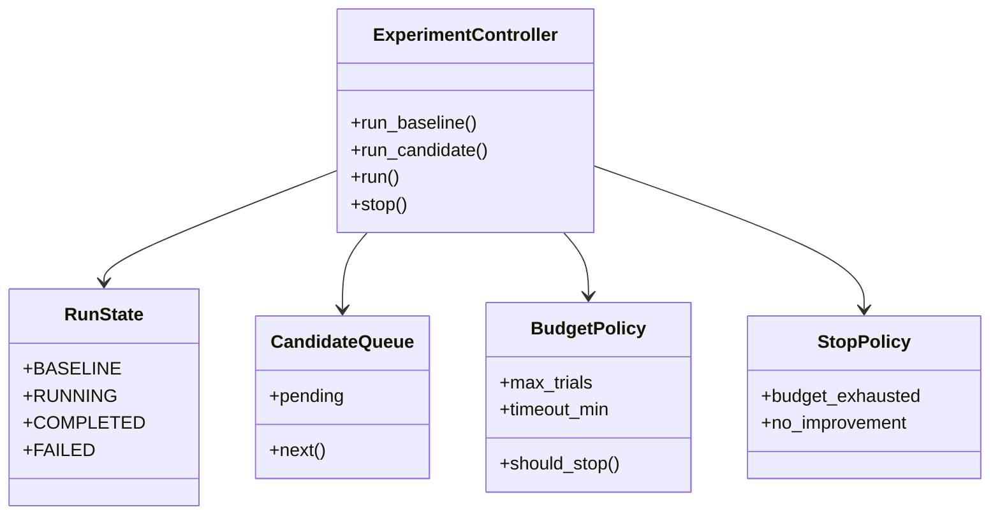
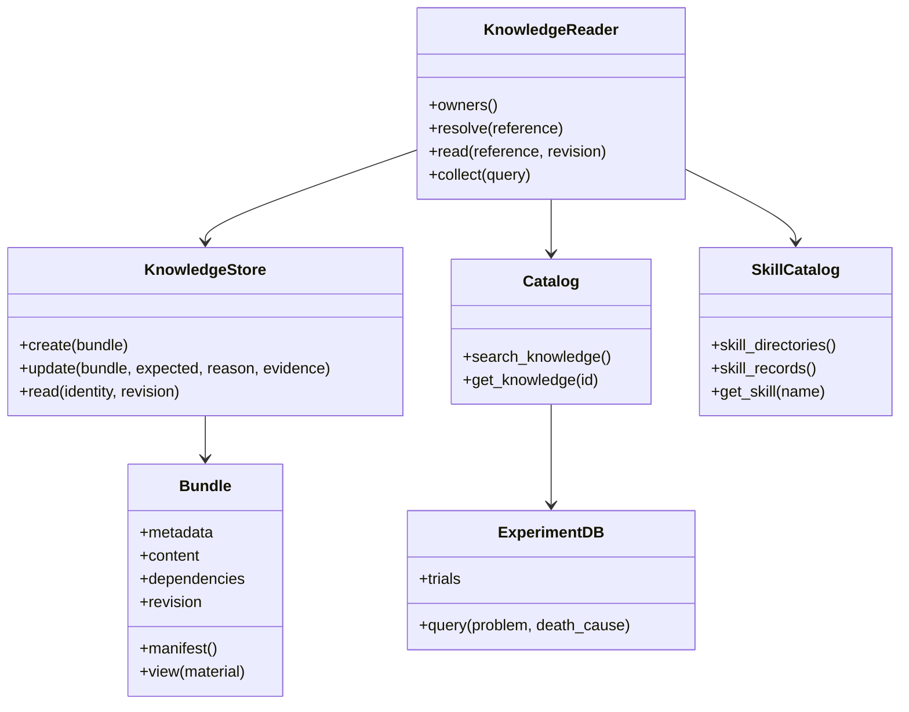
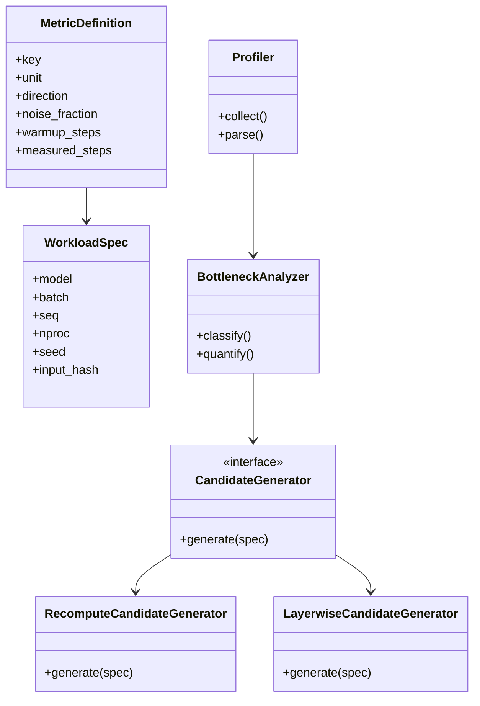
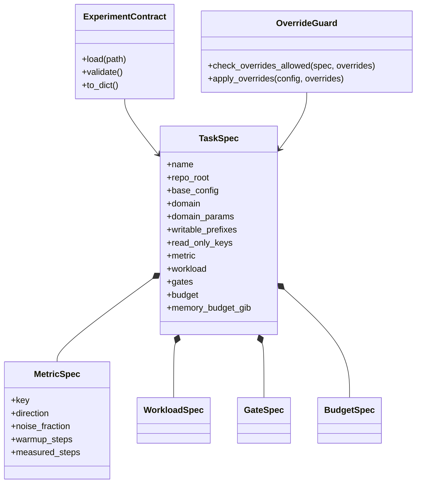
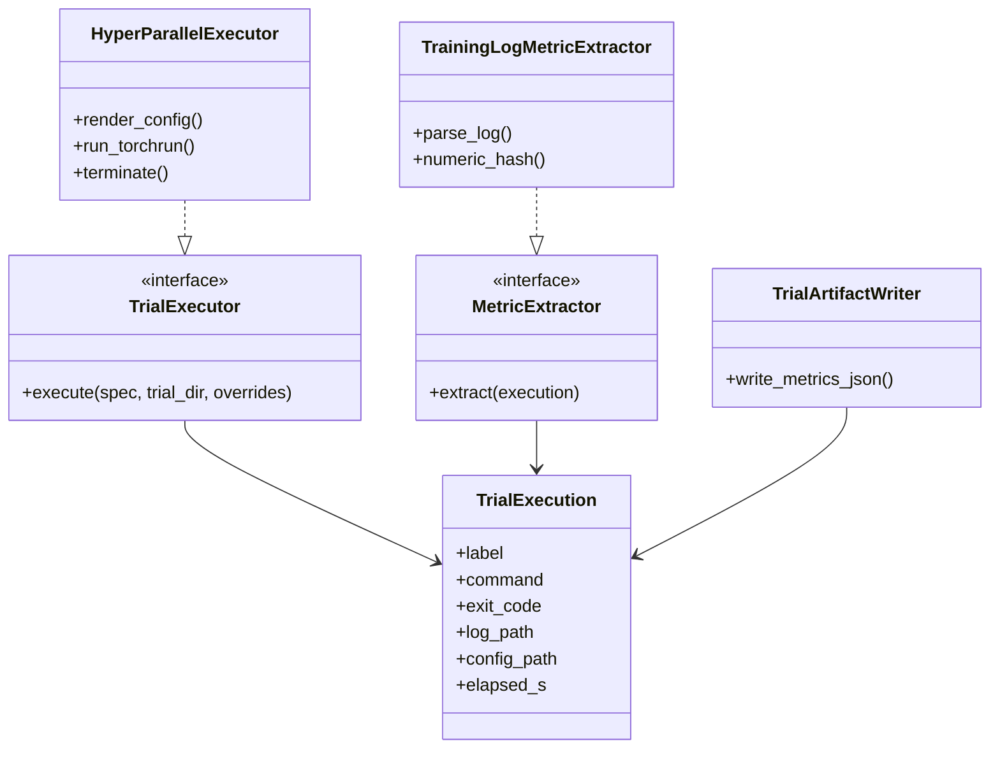
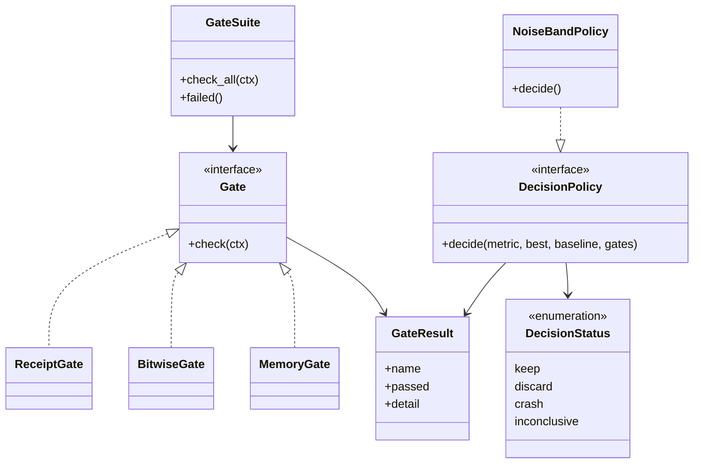
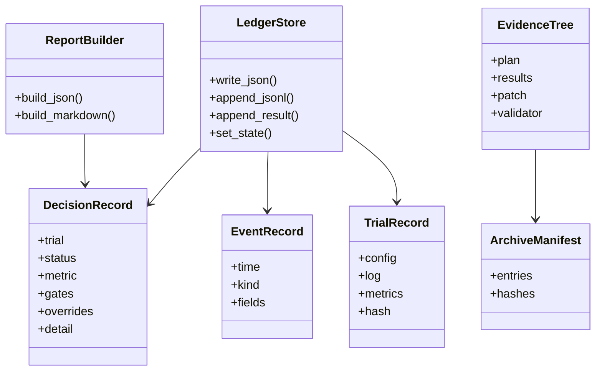
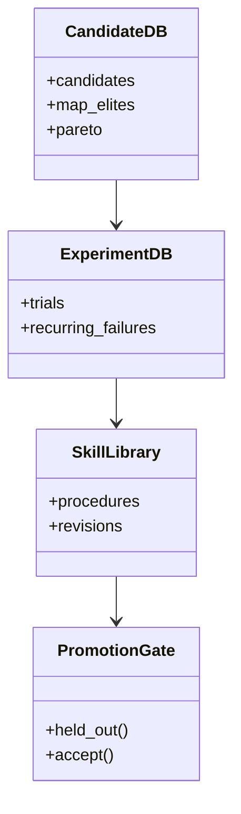
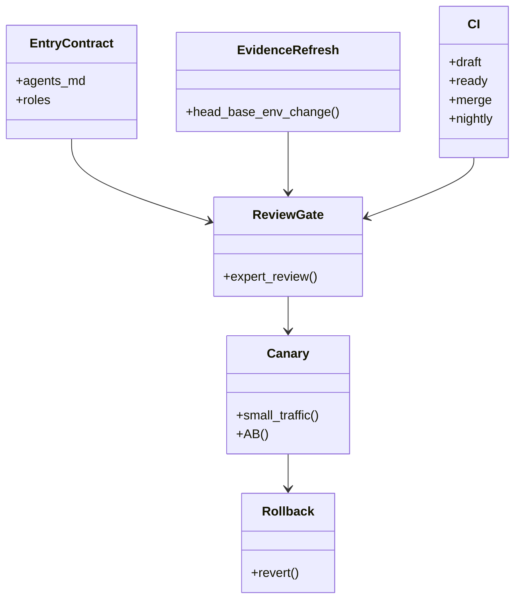

# infra-rsi 组件拆分：按“主循环 + 六层”重构

日期：2026-11-13  
基准图：`~/Downloads/AGENT_FOR_INFRA_ORCHESTRATION.svg` 的“主循环 Agent + 六层”视图。  
对照对象：`infra-rsi` 当前实现、`InferRSI` 的 Harness × Model × Infra + Knowledge/Evidence 边界、`HyperParallel PR #1517` 的 agent + skills + RSI harness。

## 0. 先明确图的层

| 层 | 回答什么 | 主要模块 |
|---|---|---|
| **主循环 Agent** | 编排者，不是一层 | 外部编码 agent、候选优先级、预算、停止条件 |
| **L1 知识与记忆** | 过去试过什么、下一个假设从哪来 | 知识包/授权知识库、实验数据库、技能库、检索/上下文导出 |
| **L2 感知与诊断** | 当前 run 哪里慢、属于哪类瓶颈 | 指标定义、Profiler 采集解析、瓶颈归因、假设候选生成、benchmark workload |
| **L3 实验基础设施** | 把“想试一个优化”变成公平、可复现、可裁决的实验 | 实验契约 / 执行与调度 / 评估与质量 |
| **L4 证据与审计** | 结果如何存证、能否追溯 | 证据树、不可变历史、归档 manifest、审计事件流 |
| **L5 进化与学习回流** | 方法本身如何变强 | 候选/程序数据库、经验与技能演进、考试式学习、晋升门禁 |
| **L6 部署与治理** | 怎么安全上线、人和 agent 怎么合作 | 专家审核、灰度/AB/回滚、入口契约/角色、证据刷新、CI、合规 |

> 这张图的关键边界：**L3 的契约、执行、评估是三个逻辑组件**；执行器不做判断，裁决独立于 agent；L4 只存证，不裁决；L1 从 L4 的 PASS 结论沉淀，不直接从 agent 叙述沉淀。

---

# 一、infra-rsi 组件级类图（按层）



**传递物（图的读法）**

| 从 | 到 | 传递物 |
|---|---|---|
| MainLoop | L1 | 查知识/先查后做 |
| L1 | MainLoop | 诊断先验、假设种子 |
| MainLoop | L2 | 单变量假设请求 |
| L1 | L2 | 诊断技能/知识先验 |
| L2 | L3_Contract | 瓶颈→候选 + workload |
| L3_Contract | L3_Execution | 冻结 RunSpec |
| L3_Execution | L3_Evaluation | trial 回执/产物 |
| L3_Evaluation | L4 | PASS/FAIL/INCONCLUSIVE + 产物 |
| L4 | L1 | 只有 PASS 结论沉淀，带证据指针 |
| L1 | L5 | 反复出现的规律性信号 |
| L5 | L1 | 技能/规程修订 |
| L6 | L4/L1 | 治理、审计、证据刷新 |

---

# 二、逐层组件内部类图

## 2.1 主循环组件



**边界**：主循环不拥有 L1/L4 状态；它只消费 L2 假设、L3 契约/执行/裁决、L4 证据摘要。

## 2.2 L1 知识与记忆



**当前 infra-rsi 状态**：只有设计文档，`KnowledgeReader/Store/Catalog/SkillCatalog/ExperimentDB` 都未实现。  
**参考来源**：InferRSI 的 `KnowledgeReader`、`KnowledgeStore`、`Bundle`、`Catalog`、`SkillCatalog`；HyperParallel PR 的 `knowledge-retrieval` 与 `perf-playbook`。

## 2.3 L2 感知与诊断



**当前 infra-rsi 状态**：`MetricDefinition`/`WorkloadSpec` 有；`Profiler`、`BottleneckAnalyzer`、真正的 `CandidateGenerator` 对象没有。当前 `domain/recompute.py` 是候选生成函数，应归到 L2。

## 2.4 L3.1 实验契约



**当前代码**：`irsi/contract.py` 基本对应 L3.1；`writable_prefixes`/`read_only_keys` 是这一层的核心安全面。

## 2.5 L3.2 执行与调度



**当前代码**：`HyperParallelBackend` 同时做执行、解析、写 `metrics.json`；应按图拆成 `TrialExecutor + MetricExtractor + TrialArtifactWriter`。

## 2.6 L3.3 评估与质量



**当前代码**：`gates/builtin.py` + `engine.py` 的决策逻辑混在一起；应把 `GateSuite` 和 `DecisionPolicy` 独立出来，并区分 `crash` 与 `inconclusive`。

## 2.7 L4 证据与审计



**当前代码**：`irsi/ledger.py` 是 L4 的雏形；缺证据树 `plan/results/patch/validator`、不可变历史、archive manifest、审计事件流。

## 2.8 L5 进化与学习回流



**当前 infra-rsi 状态**：未实现。  
**参考来源**：HyperParallel PR 的 `perf-playbook`、living docs、`knowledge-retrieval`；InferRSI 的 skill library/cases，但没有自动晋升。

## 2.9 L6 部署与治理



**当前 infra-rsi 状态**：未实现。PR #1517 的 `AGENTS.md`、rules/commands/hooks、formal-verification 是这一层的参考，但不是生产部署。

---

# 三、当前代码与目标组件的映射

| 当前模块 | 当前角色 | 按图应归到 | 拆分建议 |
|---|---|---|---|
| `irsi/contract.py` | 冻结任务/可写面 | L3.1 实验契约 | 保留为 `ExperimentContract` |
| `irsi/domain/recompute.py` | 候选生成 | L2 假设候选生成 | 改成 `CandidateGenerator` 对象 |
| `irsi/engine.py` | baseline/候选/门/决策/报告 | 主循环 + L3.3（混在一起） | 拆成 `ExperimentController` + `GateSuite` + `DecisionPolicy` + `ReportBuilder` |
| `irsi/backends/hyperparallel.py` | 执行 + 解析 + 写 metrics | L3.2 执行与调度 | 拆成 `HyperParallelExecutor` + `TrainingLogMetricExtractor` + `TrialArtifactWriter` |
| `irsi/gates/builtin.py` | 三道门 | L3.3 评估与质量 | 保留 `ReceiptGate/BitwiseGate/MemoryGate`，外层加 `GateSuite` |
| `irsi/receipt.py` | 日志解析/指纹 | L2/L3.2 指标提取 | 改成 `MetricExtractor` 实现 |
| `irsi/ledger.py` | 账本 | L4 证据与审计 | 保留 `LedgerStore`，补证据树/manifest/audit |
| `irsi/registry.py` | 插件注册 | 跨层 wiring，不是层 | 改成 typed registry：`CandidateGenerator` / `TrialExecutor` / `Gate` / `DecisionPolicy` |
| `irsi/cli.py` | 入口 | 主循环入口/ L6 入口契约 | 保留 CLI；入口契约与角色归 L6 |
| `workspace/` | 配置/数据 | L2 benchmark workload / L3 输入 | 保留为 workload 资产 |
| `report.json/md` | 报告 | L4 证据 | 由 `ReportBuilder` 生成 |

---

# 四、与 InferRSI、HyperParallel 的组件映射

| 层 | infra-rsi | InferRSI | HyperParallel PR #1517 |
|---|---|---|---|
| **主循环** | `Engine`（现状） | `harness.runner` AB/BA + `harness/optimization.py` | host Agent + `autoresearch` / `mfu-riser` controllers |
| **L1 知识** | 未实现，只有设计文档 | `knowledge/`、`KnowledgeReader`、`KnowledgeStore`、`Catalog`、`SkillCatalog`、`Bundle` | `knowledge-retrieval`、`perf-playbook`、living docs |
| **L2 感知** | `MetricSpec`/`WorkloadSpec`；无 profiler | `model/protocols` 指标/请求协议；无 profiler | `profiling`、`memory-analysis`、`moe-profiler` |
| **L3.1 契约** | `InfraTaskSpec` + `OverrideGuard` | `RunSpec` + `claim.py` | `RunConfig`、`TrainingProtocol`、`riser_contract` |
| **L3.2 执行** | `HyperParallelBackend` | `harness.runner`、`scenarios.external`、`infra.executors.local` | `autoresearch` / `mfu-riser` + HyperParallel runtime |
| **L3.3 评估** | `Gate` + Engine 决策 | `harness.evaluation` PASS/FAIL/INCONCLUSIVE | equivalence/precision/routing/formal verification |
| **L4 证据** | `TaskLedger` | run 证据 + `evidence/` tree + report | `results.tsv`、`candidates.jsonl`、living docs |
| **L5 进化** | 未实现 | skill library/cases，无自动晋升 | `perf-playbook` cases + knowledge retrieval |
| **L6 治理** | 未实现 | claim/CI/issue templates | `AGENTS.md`、rules/commands/hooks、formal-verification |

---

# 五、gap：按图看，infra-rsi 目前只是 L3+L4 的切片

| 层 | 当前覆盖 | gap |
|---|---|---|
| 主循环 | `Engine` 自动枚举/裁决 | 无 agent/planner；无 `inconclusive` 状态 |
| L1 知识 | 无运行时 | 没有知识读取、实验数据库、技能库、先查后做 |
| L2 感知 | 只有指标/ workload 定义 | 没有 Profiler、瓶颈归因、真正的假设生成器 |
| L3.1 契约 | 有 | 好，但 `domain_params` 太泛，应 typed |
| L3.2 执行 | 有 `HyperParallelBackend` | 执行/解析/写 metrics 混在一起；无隔离 workspace/source digest |
| L3.3 评估 | 有 receipt/bitwise/memory | 无 gate 分类、无 quality validation、无 engaged marker |
| L4 证据 | 有 ledger | 无证据树、不可变历史、archive manifest、audit event stream |
| L5 进化 | 无 | 无候选/程序数据库、技能演进、晋升门禁 |
| L6 治理 | 无 | 无专家审核、灰度/AB/回滚、证据刷新、CI 泳道 |

**结论**：我们不是“组件太多”，而是**组件层级不对**。当前把 L2 候选生成、L3 执行、L3 评估、L4 账本都塞进 `Engine/Backend/Gates/Domain/Evidence` 这几个大盒子；按图拆分后，infra-rsi 应该是：

```text
主循环 ExperimentController
  ├─ L2 CandidateGenerator
  ├─ L3.1 ExperimentContract
  ├─ L3.2 TrialExecutor + MetricExtractor
  ├─ L3.3 GateSuite + DecisionPolicy
  └─ L4 LedgerStore + ReportBuilder

未实现：L1 Knowledge, L5 Evolution, L6 Governance
```

**目标代码模块**：

```text
irsi/
  controller.py      主循环
  contract.py        L3.1
  candidates.py      L2
  execution.py       L3.2
  metrics.py         L2/L3.2 指标提取
  evaluation.py      L3.3
  decision.py        L3.3
  evidence.py        L4
  report.py          L4
  knowledge/         L1（未来）
  evolution/         L5（未来）
  governance/        L6（未来）
```

现有 `engine.py`、`backends/`、`gates/`、`domain/`、`receipt.py`、`ledger.py` 可以保留为兼容 shell，逐步迁移到上述模块；不要让 `Engine` 继续承担“契约+执行+评估+账本+报告”的全部职责。
