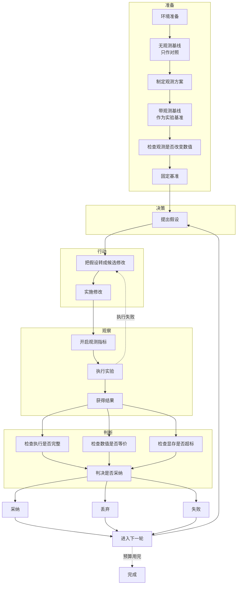
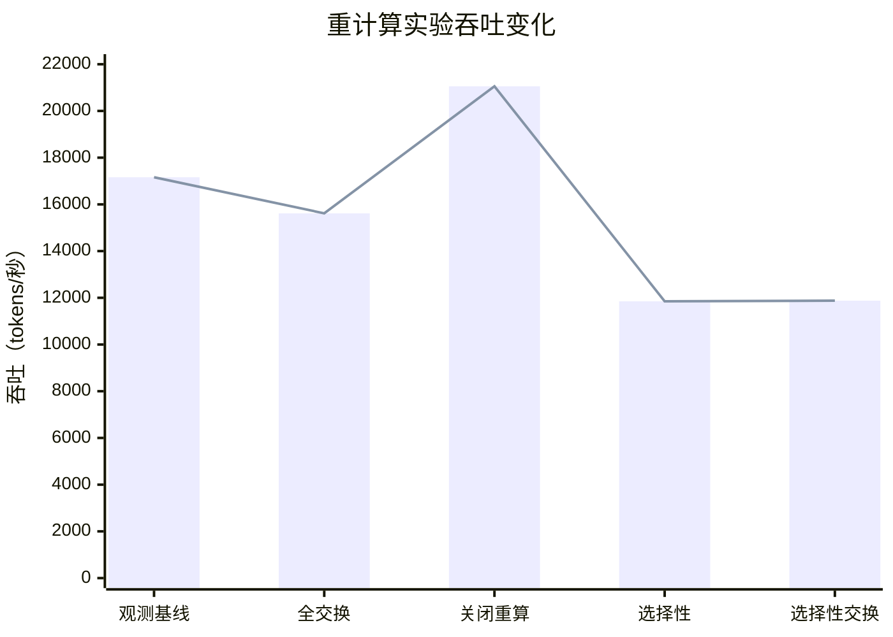
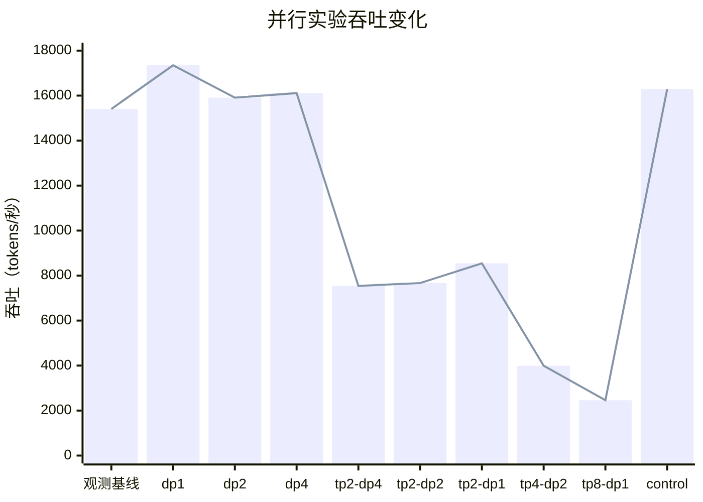

# RSI 实验报告：重计算与并行优化（2026-11-17 / 2026-11-18）

## 1. RSI 循环介绍

本轮 RSI 是代码强制的闭环实验流程，不是 Agent 自由控制流程。核心状态机：

关键约束：

- 无观测基线只作对照；实验基准固定为带观测基线。
- 观测方案按任务/轮次统一制定，与假设无关。
- 执行是确定性过程，不生成提示、不做判决。
- 每个候选只产生一个提交：采纳时提交实验配置和报告；丢弃或失败只提交报告。
- 执行失败先记录失败，再回到行动阶段修复，修复次数有上限。
- 重计算用逐位相同检查；并行策略用允许误差检查。

## 2. 重计算 RSI：910b4-126 实验配置与结果

### 2.1 实验配置

- 契约：`contracts/qwen3-0.6b-recompute.yaml`
- 运行机：`910b4-126`，8 × Ascend 910B4
- 模型：Qwen3-0.6B 架构（28 层、hidden 1024、16 heads、8 KV heads），随机初始化
- 执行：8 卡、32 步、global batch 8、micro batch 1、bf16、full determinism、seed 42
- baseline：`activation_checkpoint.mode=full`
- 候选：`off`、`control`、`selective`、`selective-swap`、`full-swap`
- budget：`max_trials=4`，因此本轮实际执行 4 个非空候选；`control` 未进入本轮执行
- gate：`receipt`、`bitwise`、`memory`
- reference：`observed baseline`；本轮 observation patch 为空，clean/observed 差异是运行噪声

### 2.2 实验结果

| 类型 | 候选 | 观测值（tps） | 判决 |
|---|---|---:|---|
| baseline（clean） | observation off，full | 16846.95 | baseline |
| baseline（observed，reference） | full | 17160.25 | calibrated |
| 候选 | full-swap | 15616.95 | discard |
| 候选 | **off** | **21054.50** | **keep** |
| 候选 | selective | 11849.80 | discard |
| 候选 | selective-swap | 11874.85 | discard |

柱状表示每个假设后的吞吐，折线表示同一序列的变化趋势；观测基线为实验基准。

结论：

- `off` 是唯一 keep，相对 observed baseline **+22.69%**。
- 峰值显存约 **9.28 GiB**，在 24 GiB 预算内。
- `selective` / `selective-swap` 明显变慢；`full-swap` 也低于 baseline。
- 所有候选的 `loss/grad_norm` 指纹完全相同（`065d26c1…`），`receipt`、`bitwise`、`memory` 三门 PASS。

## 3. 并行优化 RSI：910b4-126 实验结果

### 3.1 实验配置

- 契约：`contracts/qwen3-0.6b-parallel.yaml`
- 运行机：`910b4-126`，8 × Ascend 910B4
- 模型与 workload 同上：Qwen3-0.6B，32 步，global batch 8
- baseline：`tp_size=1`、`fsdp_config.dp_shard_size=8`、`activation_checkpoint.mode=full`
- 候选：纯 FSDP 分片（`dp4` / `dp2` / `dp1`）+ TP 组合（`tp2-dp4` / `tp2-dp2` / `tp2-dp1` / `tp4-dp2` / `tp8-dp1`）+ `control`
- gate：`receipt`、`parallel-engagement`、`numeric-parity`、`memory`
- `numeric-parity`：`rtol=0.05`、`atol=1e-4`，只比较 `loss`；`grad_norm` 作为诊断量，因为 TP/FSDP 的梯度归约与缩放不同
- observation patch 为空；clean/observed baseline 差异是运行噪声

### 3.2 实验结果

| 类型 | 候选 | 观测值（tps） | 峰值显存（GiB） | 判决 |
|---|---|---:|---:|---|
| baseline（observed，reference） | tp=1, dp_shard=8 | 15407.05 | 4.89 | calibrated |
| 候选 | **dp1**（tp=1, dp_shard=1） | **17348.45** | **11.38** | **keep** |
| 候选 | dp2（tp=1, dp_shard=2） | 15907.90 | 7.81 | discard |
| 候选 | dp4（tp=1, dp_shard=4） | 16112.65 | 5.89 | discard |
| 候选 | tp2-dp4 | 7542.16 | 4.67 | discard |
| 候选 | tp2-dp2 | 7667.68 | 6.29 | crash |
| 候选 | tp2-dp1 | 8546.08 | 9.06 | crash |
| 候选 | tp4-dp2 | 3992.97 | 3.21 | crash |
| 候选 | tp8-dp1 | 2460.85 | 2.39 | crash |
| 候选 | control | 16288.90 | 4.89 | discard |

柱状表示每个假设后的吞吐，折线表示同一序列的变化趋势；观测基线为实验基准。

结论：

- **唯一 keep 是 `dp1`**：纯 FSDP 参数复制，相对 baseline **+12.60%**，代价是峰值显存升至 11.38 GiB。
- **TP 在这个小模型上不划算**：TP2/4/8 的通信开销远大于收益，吞吐只有基线的 16–51%。
- **TP 多数被 numeric-parity 判 crash**：`tp2-dp2`、`tp2-dp1`、`tp4-dp2`、`tp8-dp1` 的 loss 轨迹超出 5% 容差。
- `tp2-dp4` 的 loss parity 通过，但吞吐 7542，远低于 best，因此 discard。
- `control` 的 +5.72% 是 no-op 漂移，不是优化收益。
- `parallel-engagement` 全部通过，证明运行时 mesh 和 ShardingPlanner 拓扑确实生效，而不是只看 YAML。

证据路径：重计算在 `results/qwen3-06b-20261117/`，并行在 `results/qwen3-06b-20261117-parallel/`；对应报告为 `docs/qwen3-0.6b-result.md` 与 `docs/qwen3-0.6b-parallel-result.md`。
